# Лабораторная работа №3 — Облачные сети. Amazon VPC

**Студент:** Пармакли Леонид  
**Группа:** IA2404ru  
**Специальность:** Прикладная информатика  
**Дисциплина:** Cloud Computing  
**Уровень:** продвинутый (задания 1–14, с оговоркой по п. 13.1)  
**Регион:** `eu-central-1` (Europe — Frankfurt)  
**Дата проведения:** 20.10.2026  
**Приложение:** Mood Diary (PHP, Twig, PostgreSQL 16)

> **Примечание о варианте.** Для расчёта по методичке условно принято `k = 25`, следовательно, `X = k mod 30 = 25`. Однако с согласия преподавателя повторно использована ранее созданная VPC `10.0.0.0/16`, а также существующие имена ресурсов. Поэтому адреса и имена ниже **фактические**, а не вычисленные по `X = 25`. Приватная подсеть с `db-server` находится в `eu-central-1b` вместо предусмотренной `eu-central-1a`.

## 1. Цель и результат работы

**Цель:** развернуть изолированную сетевую инфраструктуру Amazon VPC с публичными и приватными подсетями, отдельным bastion, управляемыми правилами доступа, временным NAT Gateway и PostgreSQL. Перенести приложение из ЛР2, чтобы приложение и база работали на разных экземплярах EC2, а к базе нельзя было напрямую подключиться из интернета.

**Полученный результат:** Mood Diary размещён на `app-sv` (`10.0.0.213`, Elastic IP `3.66.58.12`), PostgreSQL — на приватном `db-server` (`10.0.10.12`). Приложение обращается к БД по имени `db.timecapsule.internal`; после отключения локальной базы на `app-sv` сайт продолжил работать. Проверены SSH через bastion, запрет доступа к PostgreSQL от посторонней группы безопасности, изоляция приватной подсети, остановка и восстановление сервера БД.

## 2. Архитектура и план адресации — задания 1–3 и 14

### 2.1. Состав инфраструктуры

| Компонент | Фактическая конфигурация |
|---|---|
| VPC | `vpc-student-leonid-parmacli` — `10.0.0.0/16`; DNS Resolution и DNS Hostnames включены |
| Internet Gateway | `gateway-leonid-parmacli` — подключён к VPC |
| Публичная Route Table | `route-leonid-parmacli`: `10.0.0.0/16 → local`, `0.0.0.0/0 → Internet Gateway` |
| Приватная Route Table | `route-private-leonid-parmacli`: `10.0.0.0/16 → local`; без постоянного маршрута в интернет |
| Публичное приложение | `app-sv`, `10.0.0.213`, Elastic IP `3.66.58.12`, Security Group `web-sg` |
| SSH bastion | `bastion`, `10.0.1.152`, Security Group `bastion-sg` |
| Сервер PostgreSQL | `db-server`, `10.0.10.12`, без публичного IPv4, Security Group `db-sg` |
| Приватная DNS-зона | Route 53: `timecapsule.internal`, A-запись `db.timecapsule.internal → 10.0.10.12` |
| Временный NAT | Создавался на время установки/обновления пакетов и удалялся после использования |

### 2.2. Подсети

| Подсеть | Зона доступности | CIDR | Адреса, доступные для EC2 | Количество |
|---|---|---|---|---:|
| `public-a` | `eu-central-1a` | `10.0.0.0/24` | `10.0.0.4`–`10.0.0.254` | 251 |
| `public-b` | `eu-central-1b` | `10.0.1.0/24` | `10.0.1.4`–`10.0.1.254` | 251 |
| `private-a` | `eu-central-1b` (фактически) | `10.0.10.0/24` | `10.0.10.4`–`10.0.10.254` | 251 |
| `private-b` | Не зафиксирована на приложенных снимках | `10.0.11.0/24` | `10.0.11.4`–`10.0.11.254` | 251 |

В каждой `/24` AWS резервирует пять адресов: `.0` — сеть, `.1` — маршрутизатор VPC, `.2` — DNS, `.3` — резерв AWS, `.255` — широковещательный адрес. В `/16` помещаются 256 подсетей `/24`, из которых используются четыре; свободны ещё **252**.

Публичная подсеть отличается от приватной наличием маршрута `0.0.0.0/0` через Internet Gateway. Для обычного IPv4-доступа экземпляру также требуется публичный адрес. Приватные подсети напрямую в IGW не маршрутизируются.

### 2.3. Схема

**Редактируемая схема AWS:** [architecture.drawio](architecture.drawio).  
**Архитектурное решение:** [ADR-0002 — размещение PostgreSQL](docs/adr/0002-database-placement.md).

Маршрут запроса после миграции: **браузер → Internet Gateway → `app-sv` (nginx/PHP) → приватное DNS-имя Route 53 → `db-server` (PostgreSQL по TCP/5432)**. Административный SSH проходит через `bastion` с помощью `ProxyJump`.

> В `images.zip` нет отдельных снимков всех CIDR, таблиц маршрутизации и Internet Gateway. Их конфигурация описана по выполненным шагам; визуальные доказательства этих пунктов при необходимости следует дополнить скриншотами консоли AWS.

## 3. Security Groups и SSH — задания 4–5

Для EC2 созданы три группы безопасности. Исходящие правила оставлены разрешающими, входящие заданы по назначению:

| Группа | Входящий порт | Источник | Назначение |
|---|---:|---|---|
| `bastion-sg` | TCP/22 | Публичный IP администратора `/32` | SSH из интернета |
| `web-sg` | TCP/80 | `0.0.0.0/0` | HTTP на сайт |
| `web-sg` | TCP/22 | `bastion-sg` | SSH к приложению |
| `db-sg` | TCP/5432 | `web-sg` | Доступ к PostgreSQL |
| `db-sg` | TCP/22 | `bastion-sg` | Администрирование сервера БД |

**Проверка SSH:** с компьютера выполнены `ssh bastion`, `ssh web`, `ssh db`; приватные серверы доступны через bastion, а закрытый ключ остаётся на клиентском компьютере.

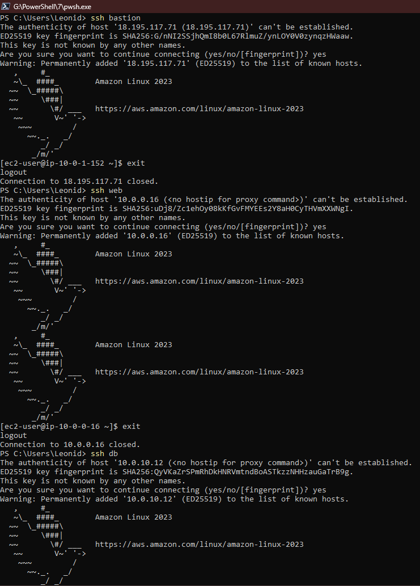

*Рис. 1 — Успешные SSH-подключения к bastion, web-server и db-server.*

На исходном `web-server` nginx был установлен через EC2 User Data. Сайт вывел hostname и приватный адрес `10.0.0.16`.

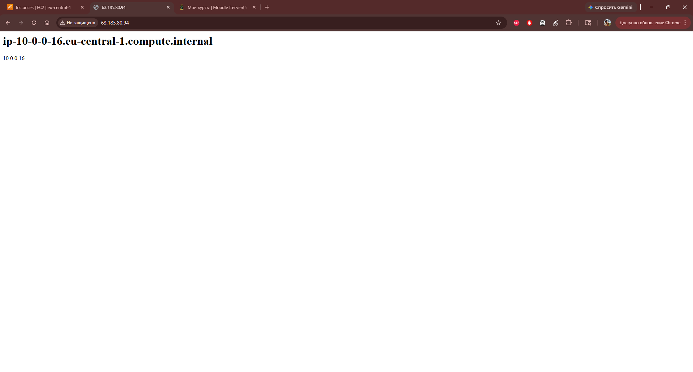

*Рис. 2 — HTTP-сервер nginx доступен по публичному IPv4.*

## 4. Приватная подсеть, NAT Gateway и PostgreSQL — задания 5–7

### 4.1. Отсутствие интернета до создания NAT

`db-server` запущен без публичного IPv4 в приватной подсети. Попытка установить `postgresql16-server` через `dnf` до добавления NAT не удалась из-за недоступности репозиториев.

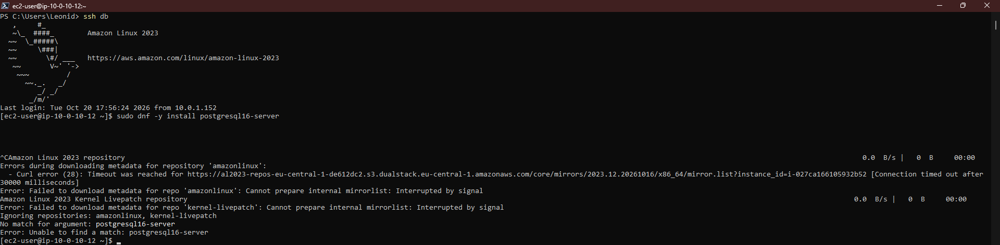

*Рис. 3 — `dnf` не может получить пакеты без маршрута в интернет.*

### 4.2. Временный NAT Gateway

Создан NAT Gateway в `public-a`, к нему привязан временный Elastic IP. После готовности шлюза в приватную Route Table добавлен маршрут `0.0.0.0/0 → NAT Gateway`.

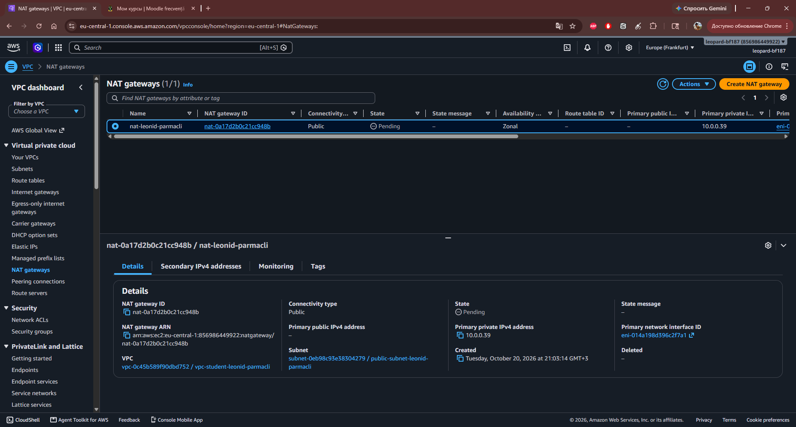

*Рис. 4 — Создан публичный NAT Gateway, первоначально в состоянии Pending.*

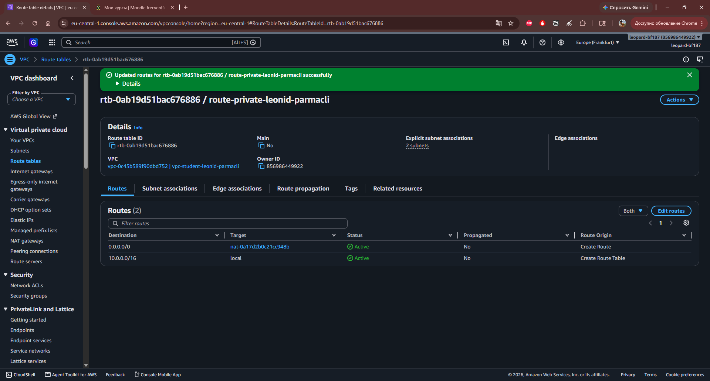

*Рис. 5 — В приватной таблице присутствует активный маршрут `0.0.0.0/0` через NAT Gateway.*

С `db-server` выполнена проверка `curl https://checkip.amazonaws.com`: получен **публичный IP шлюза**, а не самого приватного экземпляра.

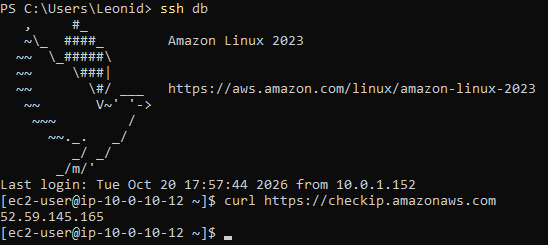

*Рис. 6 — Исходящий запрос из приватной подсети успешно проходит через NAT.*

После получения доступа в интернет выполнены `dnf update` и установка `postgresql16-server`.

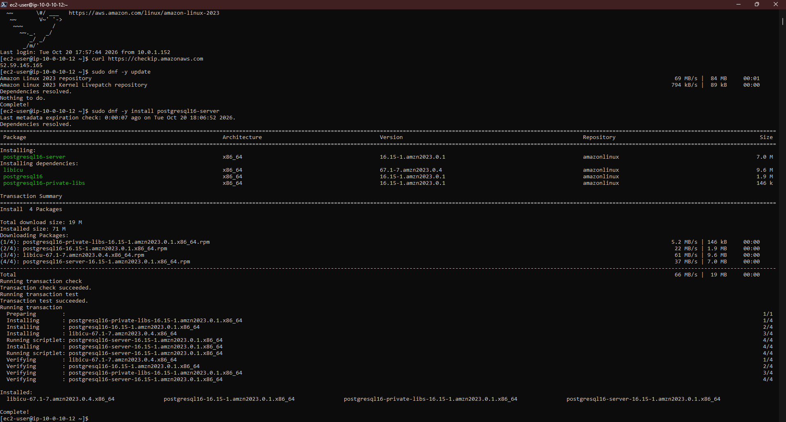

*Рис. 7 — PostgreSQL 16 установлен на `db-server`.*

### 4.3. Конфигурация базы

Выполнены инициализация кластера PostgreSQL, настройка `listen_addresses = '*'`, разрешение подключений из `10.0.0.0/24` через `pg_hba.conf` и запуск службы. Для тестирования созданы пользователь `student` и база `lab3`.

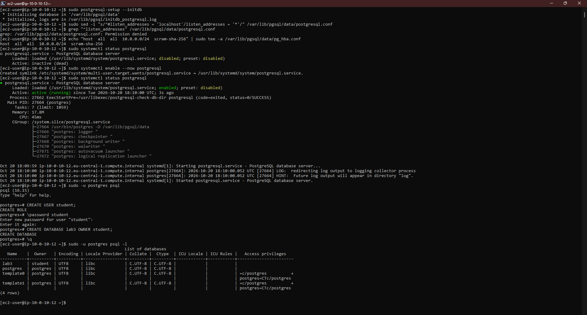

*Рис. 8 — PostgreSQL активен; в списке БД присутствует `lab3`.*

После установки NAT Gateway удалён, маршрут через него очищен, а временный Elastic IP освобождён.

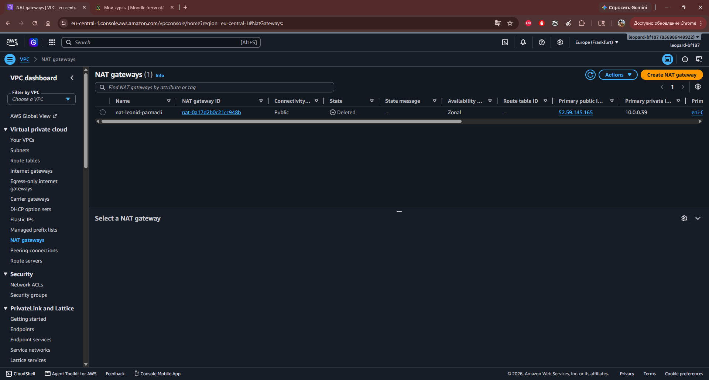

*Рис. 9 — NAT Gateway в процессе удаления (удалённый шлюз не нужен для связи внутри VPC).*

### 4.4. Проверка доступов и сетевой изоляции

На `web-server` установлен клиент `postgresql16`, затем выполнено подключение к `db-server`:

```bash
psql -h 10.0.10.12 -U student -d lab3 -c "SELECT version();"
```

Результат — **PostgreSQL 16.15**, соединение установлено.

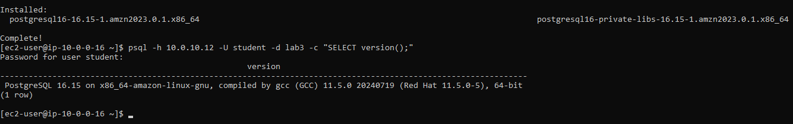

*Рис. 10 — Успешное выполнение SQL-запроса с веб-сервера по приватной сети.*

Проверка TCP/5432 показала `open` с `web-server` и `closed` с `bastion`: хотя оба EC2 находятся в VPC, `db-sg` разрешает PostgreSQL только от `web-sg`.

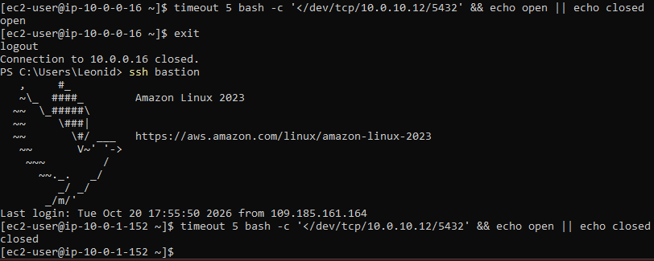

*Рис. 11 — Подтверждено разграничение сетевого доступа на уровне Security Groups.*

После удаления NAT команда `curl -m 5 https://github.com` на `db-server` завершилась тайм-аутом.

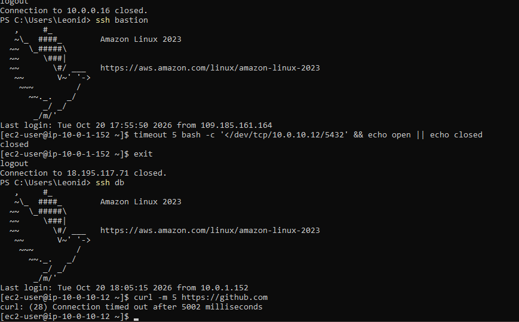

*Рис. 12 — Сервер базы не имеет постоянного выхода в интернет.*

Для проверки Network ACL временно добавлено правило `Deny` для публичного IP администратора с меньшим номером, чем стандартное разрешающее правило. SSH к bastion завершился тайм-аутом; после эксперимента правило удалено.

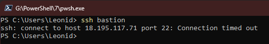

*Рис. 13 — Новое SSH-соединение заблокировано правилом Network ACL. Проверка сайта через мобильный интернет отдельно не зафиксирована.*

## 5. Перенос Mood Diary — задания 8–9

Из EC2 `webserver` лабораторной №2 создан AMI `lab3-img`, на основе которого запущен `app-sv` в собственной VPC. Файлы Mood Diary и программное окружение перенеслись вместе с образом EBS.

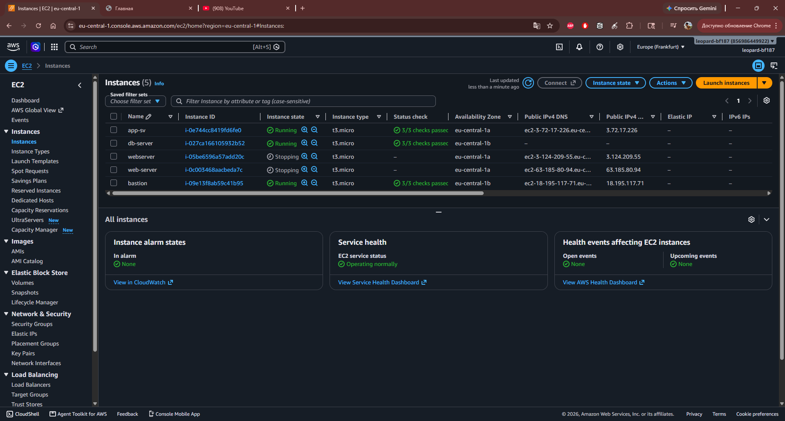

*Рис. 14 — Новая виртуальная машина `app-sv` среди экземпляров EC2.*

В `~/.ssh/config` добавлена запись `Host app` с `ProxyJump bastion`; подключение к `10.0.0.213` выполнено успешно.

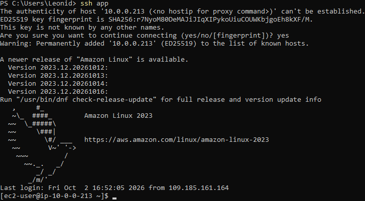

*Рис. 15 — Подключение к серверу приложения из новой VPC.*

Для `app-sv` выделен и привязан **Elastic IP `3.66.58.12`**, по которому приложение Mood Diary открывается в браузере. Рабочий каталог приложения — `/var/www/mood-diary`, конфигурация находится в `.env`.

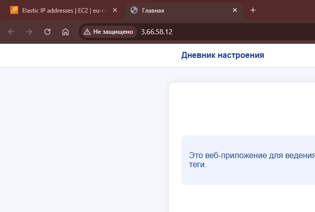

*Рис. 16 — Приложение Mood Diary доступно по постоянному публичному адресу.*

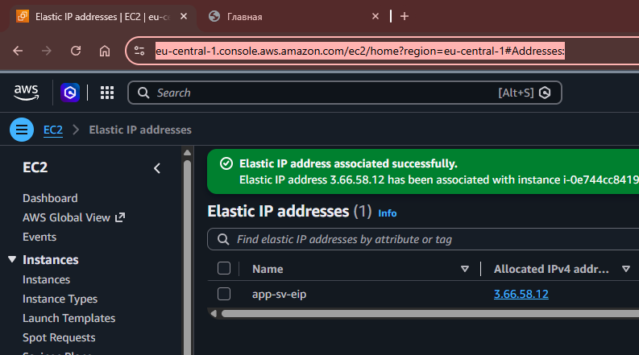

*Рис. 17 — В консоли подтверждена успешная ассоциация Elastic IP с новым экземпляром.*

## 6. Разделение приложения и БД — задания 10–12

### 6.1. Новая база для Mood Diary

На `db-server` созданы пользователь и база `mood_diary`. Доступ из подсети приложения ограничен записью `pg_hba.conf`:

```text
host  mood_diary  mood_diary  10.0.0.0/24  scram-sha-256
```

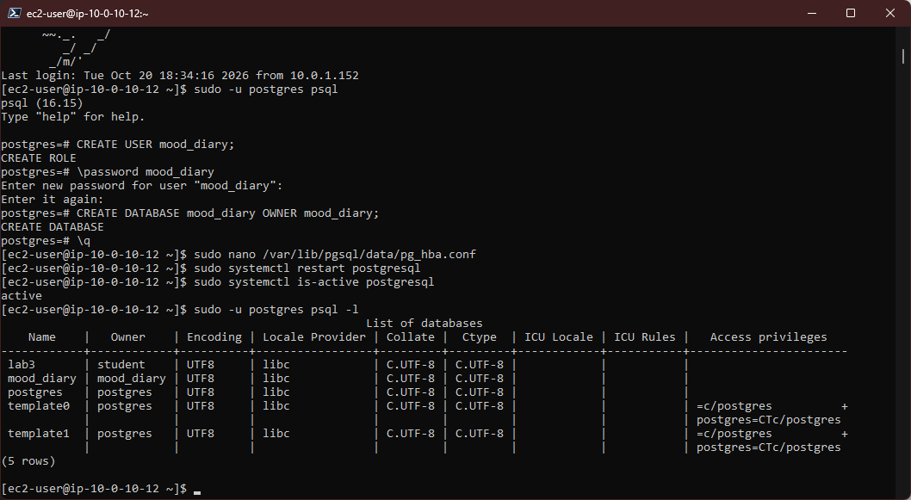

*Рис. 18 — Базы `lab3` и `mood_diary` созданы на отдельном PostgreSQL-сервере.*

### 6.2. Приватная DNS-зона Route 53

В Route 53 создана **Private Hosted Zone** `timecapsule.internal`, привязанная к учебной VPC. В ней настроена A-запись `db.timecapsule.internal → 10.0.10.12` (TTL 60 секунд).

С домашнего компьютера запрос `nslookup` **не получил адрес `10.0.10.12`**: домашний DNS-сервер возвратил сторонний ответ на неизвестное имя, что не следует принимать за реальную публичную запись приватной зоны.

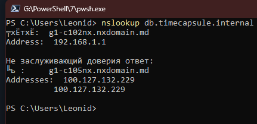

*Рис. 19 — Внешнее DNS-разрешение не возвращает приватный адрес БД.*

Напротив, с `app-sv` разрешение имени внутри VPC сработало:

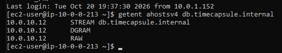

*Рис. 20 — `getent ahostsv4 db.timecapsule.internal` возвращает `10.0.10.12`.*

### 6.3. Перенос данных

Изначально локальная база Mood Diary на `app-sv` называлась **`mooddiary`** (пользователь `mooddiary`). Для отдельного PostgreSQL используется **`mood_diary`** (пользователь `mood_diary`). Содержимое перенесено с помощью логического дампа:

```bash
pg_dump -h localhost -U mooddiary -d mooddiary -Fc -f ~/lab3-backup/mooddiary.dump
pg_restore -h db.timecapsule.internal -U mood_diary -d mood_diary --no-owner --no-privileges --exit-on-error ~/lab3-backup/mooddiary.dump
```

После импорта команда `\dt` показала четыре таблицы: `entries`, `moods`, `schema_migrations`, `users`. На приложенном скриншоте также зафиксирована первоначальная ошибка ввода пароля, после которой подключение и импорт выполнены успешно.

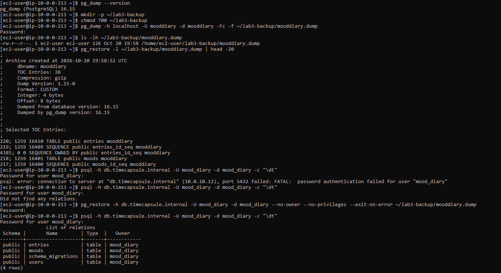

*Рис. 21 — Подтверждение переноса схемы базы и четырёх таблиц через `pg_dump` / `pg_restore`.*

В `/var/www/mood-diary/.env` адрес базы изменён на `db.timecapsule.internal`, имя и пользователь — на `mood_diary` (пароль в отчёт не включён). После `systemctl reload php-fpm` локальный PostgreSQL на `app-sv` отключён командой `sudo systemctl disable --now postgresql`. Приложение продолжило открываться и показывать данные.

## 7. Отказ базы и обновление — задание 13

### 7.1. Проверка восстановления после отказа

При остановке EC2 `db-server` эндпоинт `/health` вернул:

```json
{"status":"error","db":"error"}
```

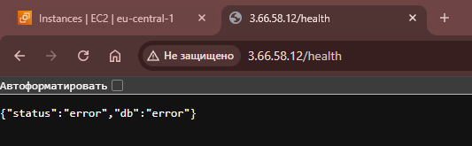

*Рис. 22 — Приложение распознало недоступность PostgreSQL.*

После запуска **того же** экземпляра БД, без правки `app-sv`, получен ответ:

```json
{"status":"ok","db":"ok"}
```

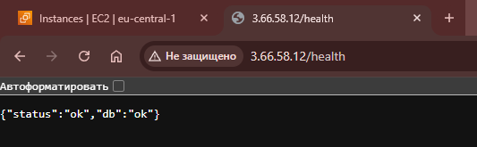

*Рис. 23 — Сервис восстановился после повторного запуска PostgreSQL.*

### 7.2. Проверка обновлений на DB Server

Для исходящего доступа временно использован NAT Gateway; на `db-server` выполнено `sudo dnf -y update`. Менеджер пакетов сообщил `Nothing to do. Complete!`, то есть доступных обновлений не обнаружено.

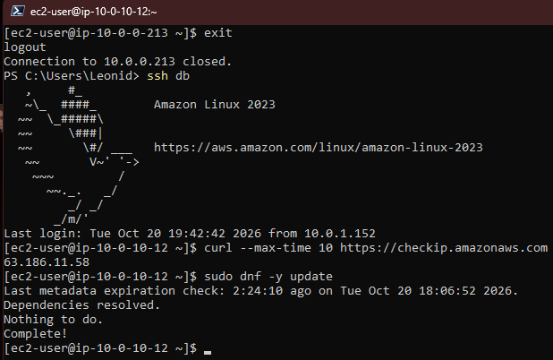

*Рис. 24 — Пакеты проверены и новых обновлений не требуется.*

После выполнения работ временные ресурсы NAT были убраны; при финальной сдаче требуется дополнительно убедиться в отсутствии NAT Gateway в состоянии `Available` и свободных Elastic IP, оставшихся от NAT.

### 7.3. Git-деплой: описание без повторного эксперимента

Механизм деплоя приложения по Git был настроен ранее во **второй лабораторной работе**. В рамках ЛР3 повторный коммит, `git push` и запуск `deploy.sh` **не выполнялись**. Перенос AMI сохранил приложение и окружение; рабочее подключение `ssh app` с `ProxyJump` позволяет использовать уже знакомый процесс деплоя. Скриншотов нового деплоя в архиве нет.

## 8. Контрольные вопросы

**1. Почему на `/24` доступен 251 IP, а не 256?** AWS резервирует первые четыре адреса и последний адрес каждой подсети. Они нужны для сети, маршрутизатора, DNS и внутренних целей AWS; широковещательная передача как обычный broadcast в VPC не используется.

**2. Почему подсеть с именем public не обязательно публичная?** Название — только тег. Нужен маршрут `0.0.0.0/0` на Internet Gateway; для IPv4-доступа EC2 также должен иметь публичный адрес и разрешённые правила доступа.

**3. Для чего в обеих Route Table существует `local`? Что произойдёт с пакетом из private-a к `8.8.8.8`?** `local` обеспечивает маршрутизацию между подсетями одной VPC. Без default route у приватной таблицы нет маршрута к внешнему адресу, поэтому пакет не достигнет интернета.

**4. Почему в `db-sg` указан источник `web-sg` вместо IP?** Доступ привязан к принадлежности отправителя к группе безопасности, а не к конкретному динамическому адресу EC2. Это упрощает замену сервера приложения и одновременно не открывает порт всем узлам VPC.

**5. Почему пакет PostgreSQL нельзя было установить без NAT?** У `db-server` нет публичного IPv4 и маршрута для исходящих интернет-соединений. Временный NAT даёт исходящий доступ для загрузки пакетов, не открывая прямой входящий доступ из интернета.

**6. Почему исходящий IP `db-server` совпадал с IP NAT, и почему БД работает после его удаления?** NAT преобразует приватный адрес источника в свой публичный при выходе в интернет. Взаимодействие `app-sv` и `db-server` остаётся внутри VPC по маршруту `local` и не требует NAT.

**7. Какие механизмы ограничивают доступ к PostgreSQL?** Отсутствие публичного IP и внешнего маршрута исключает прямую достижимость из интернета; `db-sg` разрешает TCP/5432 только от `web-sg`; `pg_hba.conf` ограничивает пользователя, базу, IP-источник и тип аутентификации. Ошибка любого отдельного уровня может нарушить безопасность или доступность.

**8. Почему с `web-server` порт 5432 открыт, а с bastion закрыт?** Оба EC2 могут маршрутизировать пакеты внутри VPC, но разрешение на вход в PostgreSQL есть только для отправителей с `web-sg`. Настроенная на bastion группа не соответствует этому правилу.

**9. Почему Network ACL заблокировал SSH, хотя Security Group не менялась?** Network ACL действует на границе подсети отдельно от Security Group. Правила проверяются по возрастанию номера, поэтому `Deny` с номером 90 сработал прежде разрешающего правила с номером 100; другой клиентский IP не попадает под тот же запрет.

**10. Для чего нужны теги `Project` и `Owner`?** `Project=timecapsule` позволяет находить связанные ресурсы для аудита, оценки затрат и последующего удаления. `Owner` отмечает ответственного даже при совместном использовании AWS-аккаунта.

**11. Почему Elastic IP закреплён за `app-sv`, но не обязателен для bastion?** Приложению нужен стабильный публичный адрес для пользователей, тогда как IP bastion можно обновлять в SSH-конфигурации при каждом запуске. Выделенный публичный IPv4 тарифицируется и при остановленном экземпляре; при появлении балансировщика клиентам можно выдавать DNS балансировщика вместо IP EC2.

**12. Почему приватная зона Route 53 работает внутри VPC, но не из обычного домашнего DNS?** Private Hosted Zone обслуживается резолвером привязанных VPC и не публикует свою A-запись в глобальную систему DNS. При изменении приватного IP БД достаточно обновить запись `db.timecapsule.internal`.

**13. Почему БД нужен пароль, если порт 5432 защищён Security Group?** Сетевые правила не заменяют аутентификацию PostgreSQL. Сильный пароль и права роли защищают базу при подключении с разрешённого узла и при ошибках будущей сетевой конфигурации.

**14. Что показал эксперимент с остановкой БД?** При остановке `/health` вернул `db:error`, а после запуска того же экземпляра — `db:ok`. Приватный адрес сохранился; конфигурация приложения и DNS не требовали правок. Это демонстрирует восстановление после ручного запуска, но не автоматическую отказоустойчивость.

**15. Как обновлять `db-server` без постоянного доступа в интернет?** На время обслуживания создаются NAT Gateway и исходящий маршрут `0.0.0.0/0`, выполняются обновления, затем маршрут и NAT удаляются, а его Elastic IP освобождается. Плата за NAT взимается за время и обработанные данные, поэтому временный режим выгоднее постоянно включённого.

**16. Где после переноса находятся пользовательские файлы?** `pg_dump` переносит данные PostgreSQL, но не файлы приложения на диске. Локальные файлы и вложения, если они есть, остались на EBS, полученном из AMI; для долгосрочного хранения нужны отдельные резервные копии или внешнее хранилище.

**17. Как обеспечить работу при отказе целой зоны доступности?** Понадобятся несколько экземпляров приложения в разных AZ за балансировщиком нагрузки, репликация или managed Multi-AZ для БД, перенос пользовательских файлов во внешнее хранилище, резервное копирование и автоматическое переключение. Наличие второй подсети само по себе отказоустойчивость не обеспечивает.

## 9. Итоги, теги и завершение работы

В рамках лабораторной реализованы собственная VPC и изолированные подсети, разграничение прав Security Group, SSH через bastion, временный NAT, PostgreSQL и приватный Route 53. Mood Diary перенесён на `app-sv`, данные восстановлены на отдельном EC2, а работа приложения проверена после отключения локальной базы и после остановки/запуска удалённого сервера PostgreSQL.

Использованы теги: `Name`, `Project=timecapsule`, `Environment=dev`, `Owner=leonid-parmacli`, `Lab=lab3`. Однако приложенный `images.zip` **не содержит финального скриншота Tag Editor**, подтверждающего наличие тегов у всех ресурсов. Также нет отдельных доказательств полного закрытия NAT/EIP после последнего обновления — эти состояния рекомендуется проверить в AWS перед защитой.

**Отклонения от методички:** унаследованный адресный диапазон и имена, `private-a` в другой AZ, отсутствие повторного теста Git-деплоя в ЛР3. Прочие описанные испытания подтверждаются материалами архива.

После окончания работы EC2 были остановлены. При этом EBS, выделенный Elastic IP приложения, AMI/snapshots и Private Hosted Zone могут продолжать тарифицироваться, пока существуют.

**Приложения к отчёту:** [архитектура draw.io](architecture.drawio), [ADR-0002](docs/adr/0002-database-placement.md), [использованные команды](commands.txt) и папка [`images/`](images/) с 24 оригинальными скриншотами.

> **Безопасность:** не добавлять в публичный репозиторий приватные ключи, пароли и `.env`. Перед публичной публикацией отчёта желательно скрыть домашний IP и идентификаторы AWS, попавшие на скриншоты.
