# Лабораторная работа №5 — Облачные базы данных. Amazon RDS

**Студент:** Пармакли Леонид  
**Группа:** IA2404ru  
**Специальность:** Прикладная информатика  
**Дисциплина:** Cloud Computing  
**Уровень:** продвинутый, с сокращением учебных заданий и части проверок  
**Дата:** 16.11.2026  
**Регион AWS:** `eu-central-1` (Frankfurt)  
**Приложение:** [MoodDiary / LaboratoryApp](https://github.com/leopard-bf187-cloud/LaboratoryApp)  
**Материалы:** [Cloud_labs, ветка Lab5](https://github.com/leopard-bf187-cloud/Cloud_labs/tree/Lab5)

---

## 1. Цель и фактический результат

**Цель:** освоить управляемую базу данных Amazon RDS for PostgreSQL, изолированный сетевой доступ, перенос данных из PostgreSQL на EC2, управление правами и автоматическую остановку экземпляра для ограничения расходов.

Вместо примера `TimeCapsule` использовано собственное PHP-приложение **MoodDiary** — дневник настроения. Оно работает на EC2 с Nginx и PHP-FPM; вложения хранятся в S3, а PostgreSQL содержит пользователей, записи, справочник настроений и метаданные вложений.

**Фактический результат:** в приватной сети создан Amazon RDS PostgreSQL; база `mood_diary` перенесена со старого EC2 `db-server` в новую `mooddiary`; данные совпали по количеству строк; Route 53 переведён на CNAME RDS; соединение PHP с новой БД и работа MoodDiary подтверждены. Созданы IAM-политика, роль и расписание EventBridge Scheduler. Старый `db-server` остановлен на время проверки.

**Граница выполненной работы:** отдельная учебная БД `lab5-db`, Read Replica, восстановление Point-in-Time, тестовая остановка Scheduler, перезагрузка/остановка самой RDS с наблюдением `/health` и CloudTrail **не выполнялись**. Эти пункты не выдаются за выполненные. Остановка старого EC2 `db-server` не является тестом остановки RDS.

## 2. Архитектура после миграции

| Компонент | Настройка |
|---|---|
| VPC | `vpc-student-leonid-parmacli`, `10.0.0.0/16` |
| Веб-приложение | EC2 `app-server`, `10.0.0.213`, Nginx + PHP-FPM |
| Администрирование | EC2 `bastion`, SSH/ProxyJump |
| Старая БД | EC2 `db-server`, `10.0.10.12`, PostgreSQL 16; после миграции остановлен |
| Новая БД | `mooddiary-dev-rds`, Amazon RDS for PostgreSQL 16, Single-AZ |
| Ресурсы RDS | `db.t4g.micro`, 20 GiB `gp3`, без автоматического расширения хранилища |
| DB Subnet Group | `mooddiary-dev-db-subnets`, две приватные подсети в разных AZ |
| Security Group | `mooddiary-dev-rds-sg`, TCP 5432 только от SG приложения |
| Сетевая доступность | Private, без публичного доступа |
| Резервные копии | Retention = **1 день** вместо 7 из методички (лимит AWS Free Plan) |
| Приватный DNS | `db.timecapsule.internal` → CNAME на endpoint RDS |
| S3 | `timecapsule-dev-uploads-leopard`, объекты в `uploads/` |
| Роль приложения | `timecapsule-dev-app-role` для S3 |
| Планировщик | EventBridge Scheduler `mooddiary-dev-rds-nightly-stop` |

В ходе подготовки выяснилось, что две исходные приватные подсети из ЛР3 размещались в `eu-central-1b`. Для соответствия требованиям RDS была создана дополнительная приватная подсеть в `eu-central-1a`. **Две AZ в DB Subnet Group не означают Multi-AZ развёртывание:** активный экземпляр RDS остаётся в одной AZ.

**[Редактируемая схема с AWS Architecture Icons](Lab5_MoodDiary_AWS_Architecture.drawio)**  
**[ADR-0004 — решение о размещении базы](docs/adr/0004-database-hosting.md)**

### Архитектурная диаграмма — светлая версия

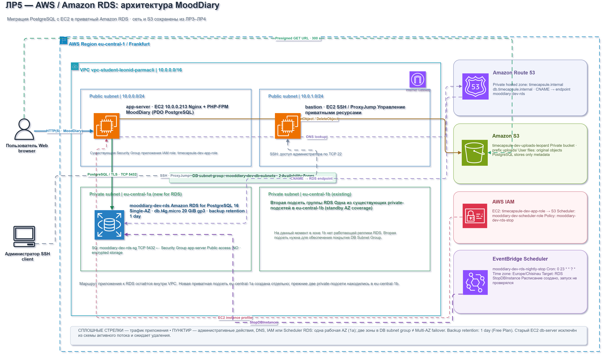

### Архитектурная диаграмма — тёмная версия

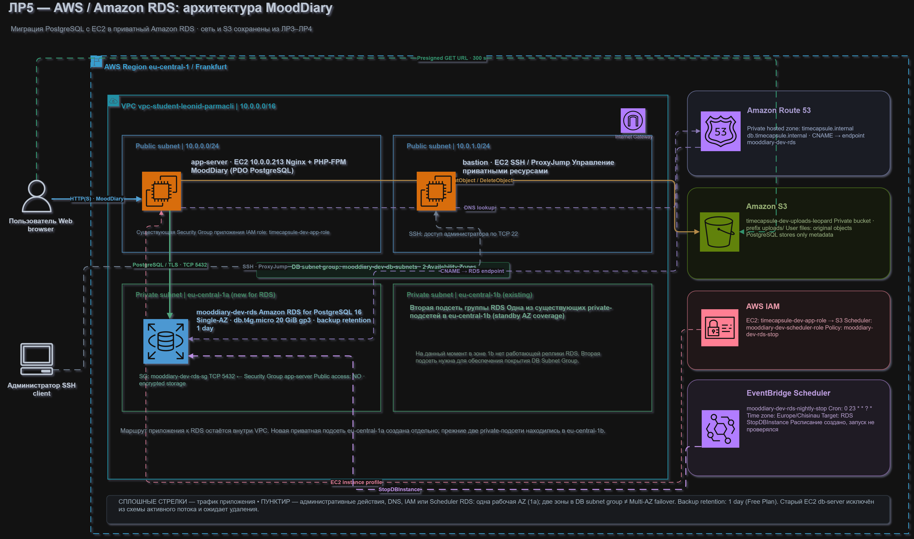

*Схема отображает целевую архитектуру. В частности, на ней показан плановый cron на 23:00, тогда как сохранённый скриншот Scheduler содержит 23:30; фактический cron нужно сверить в AWS Console.*

## 3. Подготовка сети и RDS (задания 1–3, 6)

Использована VPC из ЛР3. Первоначальная попытка создания DB Subnet Group завершилась ошибкой:

```text
The DB subnet group doesn't meet Availability Zone (AZ) coverage requirement.
Current AZ coverage: eu-central-1b.
Add subnets to cover at least 2 AZs.
```

Причина — обе старые private-подсети находились в одной AZ. Добавлена новая подсеть в `eu-central-1a`, после чего группа `mooddiary-dev-db-subnets` была создана успешно.

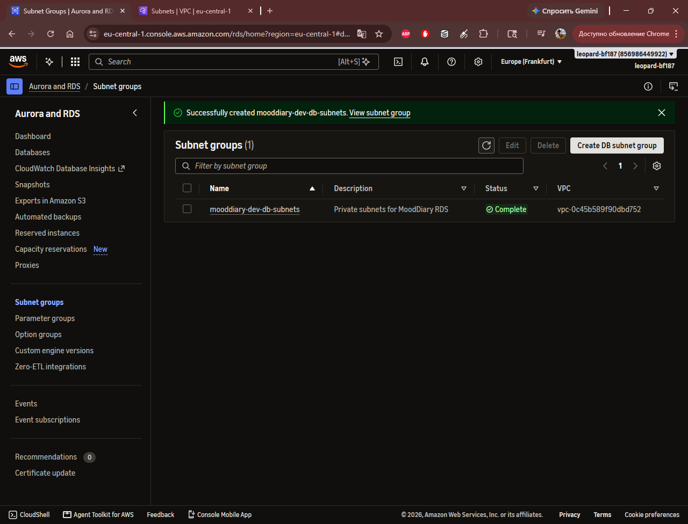

Для базы создана Security Group `mooddiary-dev-rds-sg`: входящий PostgreSQL/TCP 5432 разрешён только от группы сервера приложения, а публичный доступ к RDS отключён.

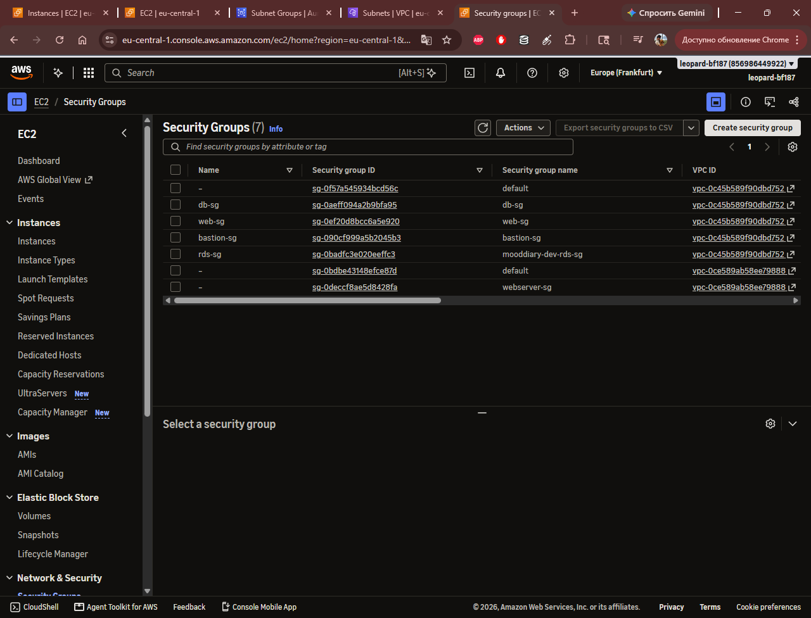

В Amazon RDS развёрнут экземпляр `mooddiary-dev-rds` с PostgreSQL 16, Single-AZ, классом `db.t4g.micro` и хранилищем `gp3` на 20 GiB.

При создании AWS отклонил срок хранения автоматических резервных копий 7 дней:

```text
The specified backup retention period exceeds the maximum available
to free tier customers.
```

После уменьшения retention до **1 дня** экземпляр успешно создан и перешёл в состояние `Available`.

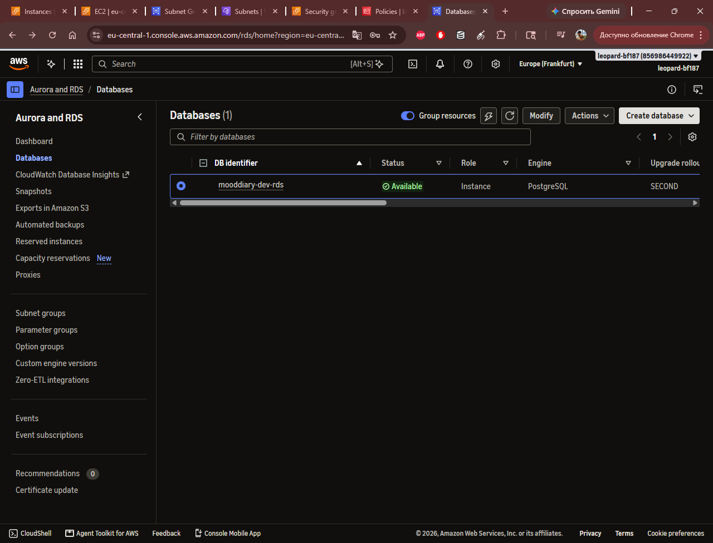

## 4. IAM и EventBridge Scheduler (задание 7)

Для автоматической остановки RDS созданы:

- **IAM policy** `mooddiary-dev-rds-stop`: право `rds:StopDBInstance` только для `mooddiary-dev-rds`;
- **IAM role** `mooddiary-dev-scheduler-role` с доверенной службой `scheduler.amazonaws.com`;
- **EventBridge Scheduler** `mooddiary-dev-rds-nightly-stop`, состояние `Enabled`, часовой пояс `Europe/Chisinau`.

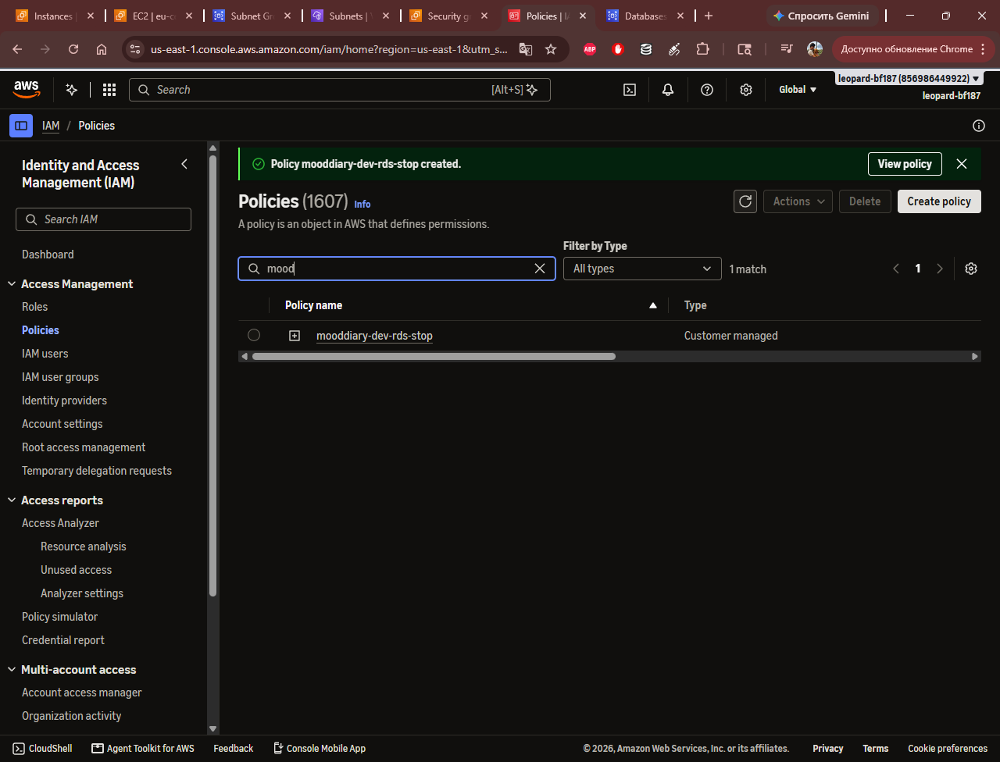

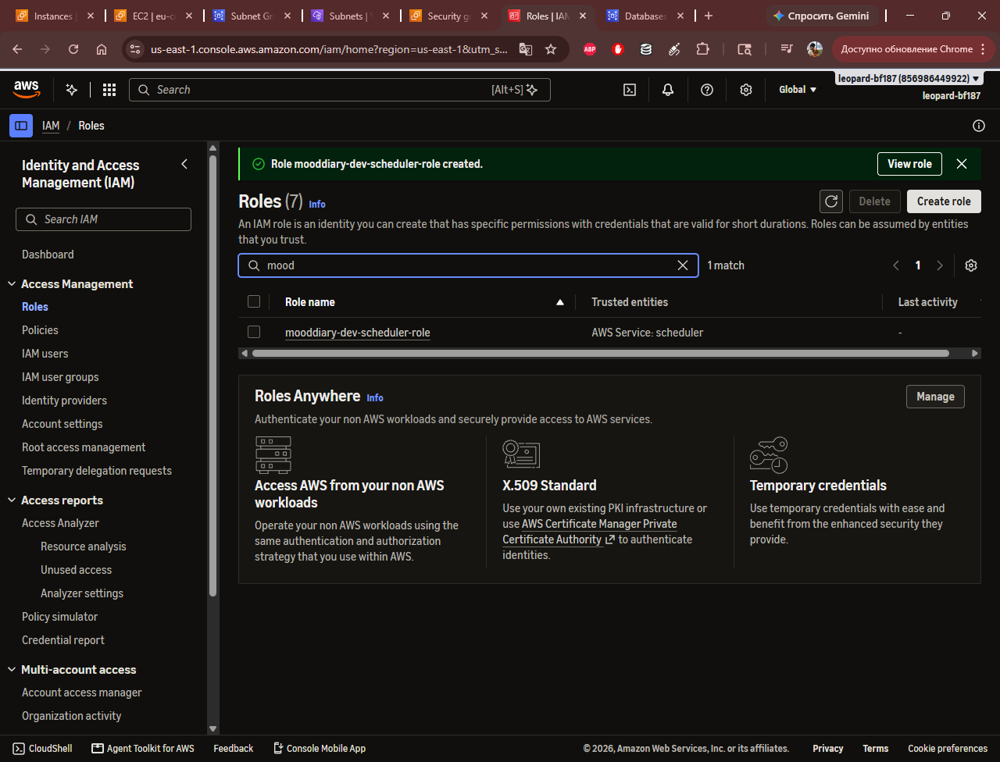

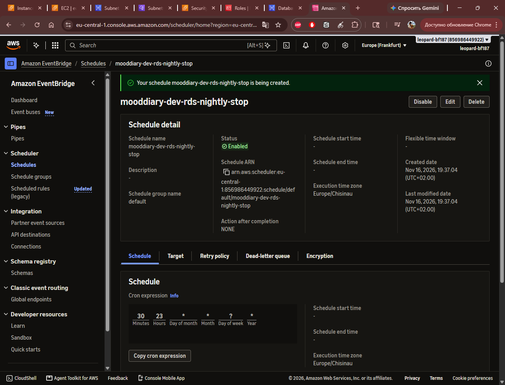

На сохранённом скриншоте расписание имеет **cron `30 23 * * ? *`** — ежедневно в 23:30. В проектной схеме указан вариант 23:00 (`0 23 * * ? *`). В AWS необходимо проверить, какое значение сохранено сейчас. **Тест фактического срабатывания расписания был пропущен.**

Сохранены материалы [policy.txt](policy.txt), [role.txt](role.txt) и [StopDBInstance.txt](StopDBInstance.txt). Файл `policy.txt` содержит шаблон `ACCOUNT_ID`, поэтому сам по себе не доказывает действительность ARN в AWS: фактическую IAM-политику требуется сверять в консоли.

## 5. Создание пользователя и базы (задание 8)

Под административной учётной записью `dbadmin` создан пользователь приложения и отдельная база данных:

```sql
CREATE USER mooddiary;
-- Пароль установлен интерактивно командой \password mooddiary
GRANT mooddiary TO dbadmin;
CREATE DATABASE mooddiary OWNER mooddiary;
```

В результате команда `\l` показала базу `mooddiary` с владельцем `mooddiary`.

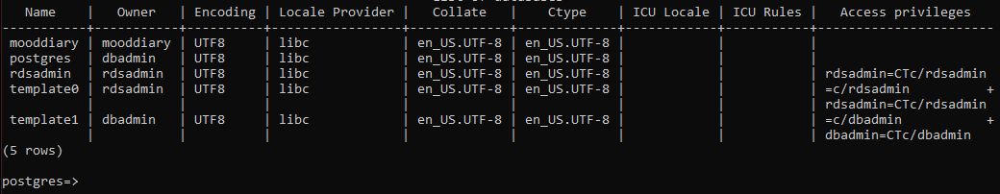

Административная учётная запись `dbadmin` не используется PHP-приложением. Пароли в отчёте отсутствуют.

## 6. Миграция из PostgreSQL на EC2 (задание 9)

Исходная конфигурация приложения:

| Параметр | На EC2 до миграции | После миграции в RDS |
|---|---|---|
| Host | `db.timecapsule.internal` | `db.timecapsule.internal` (через CNAME) |
| PostgreSQL database | `mood_diary` | `mooddiary` |
| User | `mood_diary` (при экспорте) | `mooddiary` |
| Port | 5432 | 5432 |
| Движок | PostgreSQL 16 на EC2 | PostgreSQL 16 в RDS |

Во время диагностики выяснилось, что на старом сервере исходный пользователь называется `mood_diary`, а не `mooddiary`. После использования правильного имени удалось создать дамп.

### 6.1. Экспорт с app-server

```bash
umask 077
pg_dump -h db.timecapsule.internal -p 5432 -U mood_diary -d mood_diary --no-owner --no-privileges -f ~/mooddiary-lab5.sql
```

Флаги `--no-owner` и `--no-privileges` позволяют восстановить таблицы с владельцем нового пользователя без переноса старых ролей и GRANT.

### 6.2. Импорт в RDS

```bash
psql "host=RDS_ENDPOINT port=5432 dbname=mooddiary user=mooddiary sslmode=require" -X -v ON_ERROR_STOP=1 --single-transaction -f ~/mooddiary-lab5.sql
```

`RDS_ENDPOINT` в примере — адрес экземпляра из AWS Console. Команда успешно завершила восстановление схемы и данных.

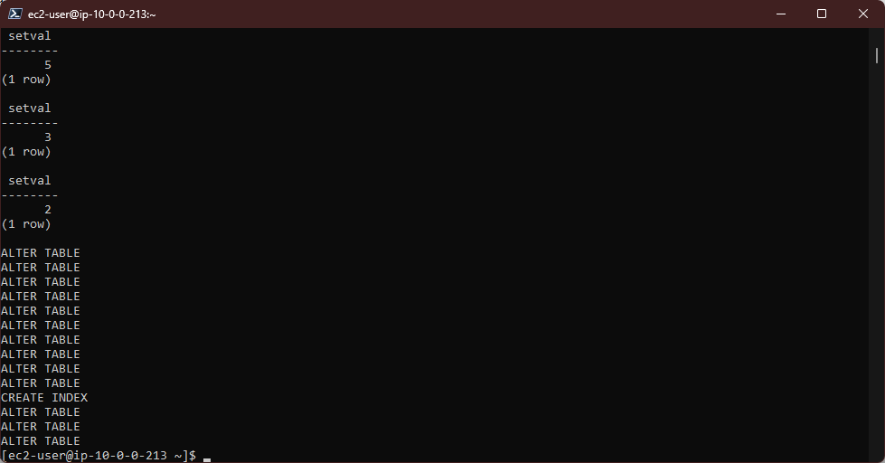

### 6.3. Сверка данных

Количество строк в исходной БД и RDS сравнили для реальных таблиц MoodDiary:

| Таблица | Исходная БД | RDS | Результат |
|---|---:|---:|---|
| `users` | 2 | 2 | Совпадает |
| `entries` | 2 | 2 | Совпадает |
| `moods` | 5 | 5 | Совпадает |
| `entry_attachments` | 1 | 1 | Совпадает |

Дополнительно команда `\dt` подтвердила наличие `schema_migrations` и владельца `mooddiary` у всех пяти таблиц.

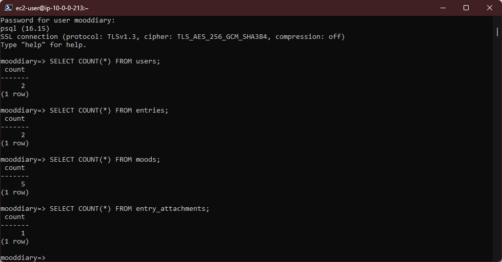

Содержимое пользовательских вложений не мигрировало вместе с PostgreSQL: оно по-прежнему находится в Amazon S3. В таблице `entry_attachments` хранятся только метаданные.

## 7. Переключение приложения на RDS (задание 10)

В приватной Route 53 Hosted Zone `timecapsule.internal` прежняя запись `A`, направленная на EC2 `10.0.10.12`, заменена на `CNAME` с endpoint Amazon RDS. Благодаря этому адрес `DB_HOST=db.timecapsule.internal` в приложении сохранился.

```bash
dig +short db.timecapsule.internal CNAME
psql "host=db.timecapsule.internal port=5432 dbname=mooddiary user=mooddiary sslmode=require"
```

Проверка вернула доменное имя RDS и успешное подключение к базе `mooddiary`. В SQL-сессии зафиксирован TLS 1.3 и приватный IP RDS `10.0.20.225`.

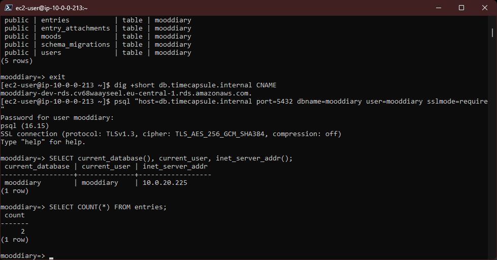

В файле `/var/www/mood-diary/.env` изменены название базы и пароль пользователя RDS, параметры S3 оставлены прежними. Затем PHP-подключение проверено через `src/Core/Database.php`:

```text
Database: mooddiary
```

После переключения приложение открылось и показало две существующие записи дневника, двух пользователей и сведения о бакете S3.

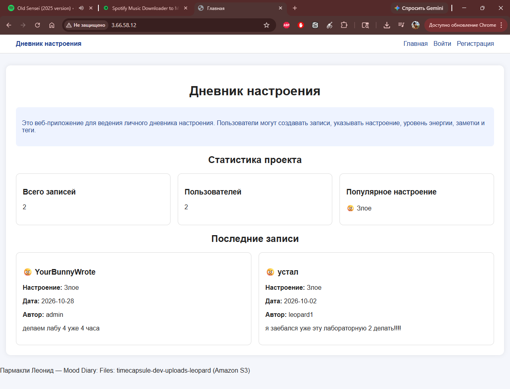

Старый `db-server` был остановлен, после чего приложение продолжало открываться. Это подтвердило отсутствие необходимости в старой EC2 PostgreSQL для текущей работы сайта. Удаление старого экземпляра отдельно не подтверждено.

## 8. Обслуживание RDS и диагностика (задание 11, частично)

В MoodDiary реализован маршрут `/health` в файле `public/health.php`. Он выполняет `SELECT 1` через PDO и возвращает:

- `{"status":"ok","db":"ok"}` при доступной БД;
- HTTP 500 с `{"status":"error","db":"error"}` при ошибке соединения.

В материалах сохранены оба варианта ответа:

| Недоступность БД — пример вывода | Успешная проверка — пример вывода |
|---|---|
| 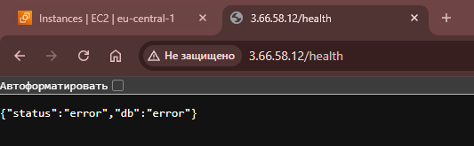 | 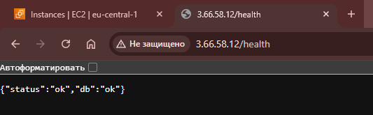 |

**Эти скриншоты демонстрируют работу механизма `/health`, но не служат доказательством перезагрузки RDS.** Отдельный эксперимент с `Reboot`, `Stop temporarily`, журналом `Logs & events` и вызовом `StopDBInstance` в CloudTrail не проводился.

Ожидаемое поведение при недоступности RDS — ошибка HTTP 500 на `/health`; при восстановлении соединения — HTTP 200 и статус `ok`. Это вывод из реализации PHP, а не наблюдение специального теста reboot.

## 9. Архитектурное решение (задание 12)

Выбрана **RDS for PostgreSQL Single-AZ**: AWS управляет инфраструктурой СУБД и резервным копированием, а приложение сохраняет привычный интерфейс PostgreSQL. Настройка остаётся учебной: выделен один экземпляр без автоматического failover между AZ, поэтому отказ `eu-central-1a` приведёт к недоступности БД.

В [ADR-0004](docs/adr/0004-database-hosting.md) сопоставлены PostgreSQL на EC2, RDS Single-AZ, RDS Multi-AZ и Aurora PostgreSQL-Compatible, а также обсуждаются стоимость, ограничение резервного копирования, DNS и последствия отказа AZ.

Методичка оценивает работу базы `db.t4g.micro` с 20 GiB `gp3` при ~3 часах в день в течение трёх месяцев примерно в **$13–14**. Это ориентир из задания, не подтверждённый фактический счёт. Хранилище тарифицируется даже для остановленного RDS. После семи дней остановки сервис автоматически запускает экземпляр, поэтому расписание его периодической остановки полезно, но требуется контроль исполнения и AWS Billing.

## 10. Ответы на контрольные вопросы

**1. Почему для Security Group лучше указывать источник SG, а не IP?**  
Адрес EC2 может измениться при пересоздании или изменении сети. Ссылка на SG ограничивает доступ экземплярами, к которым она применяется, без необходимости поддерживать список IP вручную.

**2. Зачем две приватные подсети, если RDS работает в одной AZ?**  
DB Subnet Group должна обеспечивать покрытие разных AZ в регионе. Однако это не делает экземпляр Single-AZ отказоустойчивым — автоматическое переключение возможно только при соответствующей конфигурации Multi-AZ.

**3. Чем Read Replica отличается от Multi-AZ?**  
Read Replica используется преимущественно для разгрузки запросов чтения и получает изменения асинхронно. Multi-AZ обеспечивает резервирование основного экземпляра и механизм автоматического failover; реплика для чтения сама по себе не заменяет резервное копирование.

**4. Почему репликация не заменяет backup?**  
Удаление или ошибочное изменение данных обычно реплицируется вместе с правильными изменениями. Резервная копия и журналы транзакций позволяют восстановить состояние на выбранный поддерживаемый момент, если он доступен в окне хранения.

**5. Почему отдельный пользователь `mooddiary` лучше `dbadmin`?**  
PHP-приложению не нужны полномочия администратора всей RDS. Отдельная роль ограничивает последствия ошибки или компрометации приложения и упрощает разграничение прав.

**6. Почему после миграции не изменился `DB_HOST`?**  
Приложение обращается по частному DNS-имени `db.timecapsule.internal`. В Route 53 значение A было заменено на CNAME к endpoint RDS, а само логическое имя хоста осталось неизменным.

**7. Какие обязанности перешли к AWS после миграции?**  
AWS управляет инфраструктурой экземпляра RDS, автоматическими резервными копиями и регламентом обслуживания платформы. Разработчик по-прежнему отвечает за схему, данные, доступ приложения, конфигурацию, мониторинг расходов и проверку восстановления.

**8. Что происходит с `/health` при недоступной БД?**  
В MoodDiary проверка делает `SELECT 1`. При ошибке PDO возвращается HTTP 500 с `db:error`, а при успешном соединении — HTTP 200 с `db:ok`; дополнительный тест во время reboot RDS не проводился.

**9. Меняется ли endpoint RDS после Stop/Start?**  
DNS-имя endpoint обычно остаётся тем же; его IP-адрес может измениться. Поэтому приложению следует использовать DNS-имя, а не жёстко закреплённый IP RDS.

**10. Что случится при отказе `eu-central-1a`?**  
Поскольку выбран Single-AZ, приложение потеряет доступ к БД, пока сервис не восстановится или не будет выполнено восстановление/миграция на доступную инфраструктуру. Для автоматического failover следует применять Multi-AZ, что увеличивает расходы.

**11. Зачем EventBridge отдельная роль?**  
Scheduler исполняет действие AWS API от имени своей IAM-роли, а не от лица пользователя, который настроил расписание. Разрешение `rds:StopDBInstance` целесообразно ограничить ARN единственного экземпляра, чтобы расписание не могло останавливать другие БД.

**12. Что даёт retention = 1 day и сколько данных можно потерять?**  
Окно PITR ограничено одним днём истории, а не гарантирует нулевую потерю данных: доступная последняя точка восстановления может отставать от текущего момента. Восстановление до точки во времени создаёт новый экземпляр и потребует переключения приложения.

**13. Что происходит после семи дней остановки RDS?**  
AWS автоматически запускает остановленный экземпляр для обслуживания. Поэтому отключение на ночь требует работающего расписания и периодической проверки состояния, иначе вычислительные ресурсы могут снова тарифицироваться.

**14. Как запрос проходит от браузера до базы?**  
Браузер обращается к Nginx на EC2, запрос обрабатывает PHP-FPM, а PHP использует PDO PostgreSQL. DNS в приватной Route 53 разрешает `db.timecapsule.internal` в endpoint RDS; SG допускает TCP 5432 только от группы приложения, затем PostgreSQL проверяет TLS/учётные данные и SQL-права.

## 11. Вывод

В лабораторной выполнена основная продвинутая задача: база MoodDiary перенесена с самостоятельно обслуживаемого PostgreSQL на EC2 в приватный Amazon RDS. Данные успешно выгружены и восстановлены, таблицы и количество записей совпадают, приложение подключено по прежнему DNS-имени и продолжило работать после остановки старого сервера. Управляемый сервис упрощает эксплуатацию, но при выбранном Single-AZ и однодневном backup retention сохраняются ограничения по доступности и глубине восстановления.

Дополнительные учебные задачи Read Replica/PITR и часть тестов обслуживания были сознательно сокращены. Фактическое исполнение Scheduler и завершение очистки старой инфраструктуры остаются отдельными контрольными действиями.

---

## Приложения и материалы

- [Редактируемая схема AWS (.drawio)](Lab5_MoodDiary_AWS_Architecture.drawio)
- [ADR-0004: database-hosting](docs/adr/0004-database-hosting.md)
- [Команды выполнения](commands.txt)
- [IAM policy — сохранённый шаблон](policy.txt)
- [IAM trust policy](role.txt)
- [StopDBInstance input](StopDBInstance.txt)
- [Исходники MoodDiary](https://github.com/leopard-bf187-cloud/LaboratoryApp)
