# Лабораторная работа №2 — Облачные вычислительные сервисы. Amazon EC2

**Студент:** Пармакли Леонид, IA2404ru  
__Преподаватель курса:__ *Нартя Никита*  

---

## 1. Цель работы

Цель работы — получить практический опыт работы с Amazon EC2: создать и настроить виртуальный сервер, подключиться к нему по SSH, выполнить базовую диагностику, развернуть собственное PHP-приложение с PostgreSQL, настроить nginx и PHP-FPM, организовать доставку исходного кода из GitHub и реализовать простой процесс обновления и отката приложения.

В качестве приложения использована ранее разработанная индивидуальная работа по PHP — «Дневник настроения». Приложение использует PHP, Twig, PDO и PostgreSQL, поддерживает авторизацию и хранение записей пользователя.

> По разрешению преподавателя задание со статическими HTML-страницами было пропущено, после проверки SSH-подключения был выполнен переход к продвинутой части лабораторной работы.

---

# 2. Подготовка приложения к развёртыванию

До переноса приложения в AWS были исправлены проблемы, которые могли проявиться при запуске под Linux.

### 2.1. Исправление подключения к базе данных

Из `src/Core/Database.php` были удалены обращения к несуществующей глобальной переменной `$pdo`. Настройки PDO теперь задаются при создании соединения внутри `Database::getConnection()`.

### 2.2. Исправление регистра имён файлов

Windows обычно использует файловую систему без учёта регистра, а Linux различает имена файлов по регистру. Поэтому в `public/index.php` были исправлены пути:

```php
require_once __DIR__ . '/../src/Core/CSRF.php';
require_once __DIR__ . '/../src/Helpers.php';
```

### 2.3. Исправление системы миграций

Изначально несколько миграций объявляли одинаковые глобальные функции `up()` и `down()`, что приводило бы к повторному объявлению функций. Миграции были переведены на формат, в котором каждый файл возвращает массив с замыканиями `up` и `down`, а `migrate.php` последовательно применяет ещё не выполненные миграции.

Локальная проверка после исправления:

```text
Пропущена: 001_create_mood_diary_tables.php
Пропущена: 002_add_users_and_auth.php
Миграции успешно применены.
```

### 2.4. Вынос параметров БД в `.env`

Пароль и параметры PostgreSQL были удалены из `config.php`. Локальные и серверные настройки теперь хранятся в `.env`, который исключён из Git.

Пример `.env.example`:

```ini
DB_HOST=localhost
DB_PORT=5432
DB_NAME=mooddiary
DB_USER=mooddiary
DB_PASSWORD=change_me
DB_CHARSET=utf8
```

В `.gitignore` добавлены:

```gitignore
/.env
/vendor/

/.idea/
/.vscode/

*.log
```

Это позволяет хранить исходный код в публичном репозитории без публикации пароля БД и без добавления Composer-зависимостей в Git.

---

# 3. Часть 1. Создание и проверка EC2

## 3.1. Настройка бюджета AWS

В AWS Billing and Cost Management был создан бюджет с нулевым порогом. Он используется для контроля возможных расходов во время выполнения лабораторной работы.

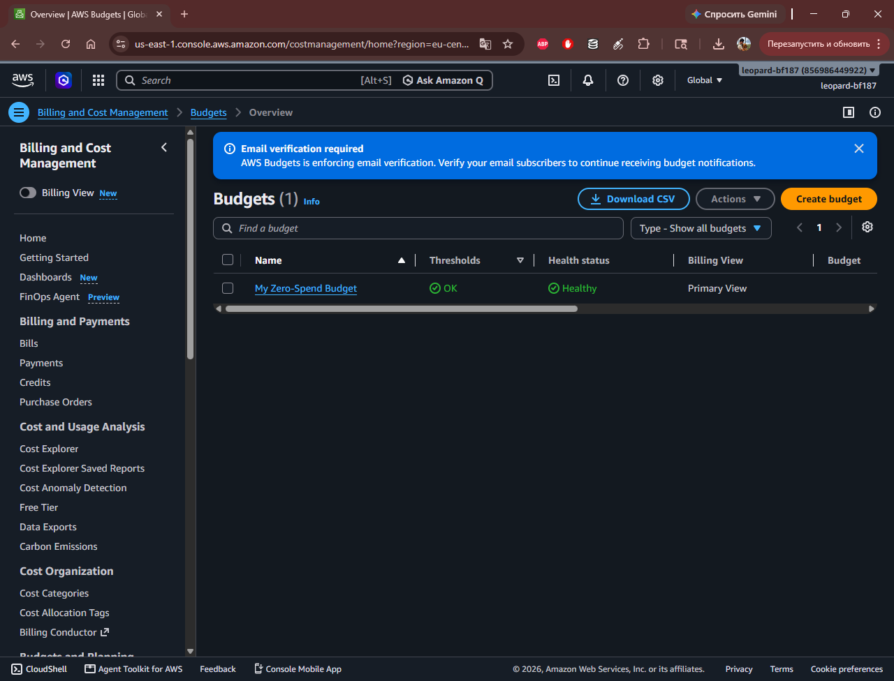

**Результат:** бюджет активен, состояние — `Healthy`.

### Ответ на вопрос: что разрешает AdministratorAccess и почему нельзя постоянно использовать root?

`AdministratorAccess` предоставляет пользователю IAM полный доступ к ресурсам и операциям AWS, но пользователь остаётся отдельной управляемой учётной записью. Root-аккаунт имеет максимальные полномочия, включая критические операции с самим аккаунтом, поэтому его постоянное использование увеличивает последствия компрометации учётных данных. Для повседневной работы безопаснее использовать IAM-пользователей и выдавать им только необходимые права.

---

## 3.2. Запуск экземпляра EC2

Экземпляр был создан в регионе:

```text
eu-central-1 — Europe (Frankfurt)
```

Основные параметры:

```text
Name: webserver
AMI: Amazon Linux 2023
Instance type: t3.micro
Public IPv4: enabled
```

Для входящего трафика создана Security Group:

- SSH, TCP 22 — только с моего IP;
- HTTP, TCP 80 — `0.0.0.0/0`.

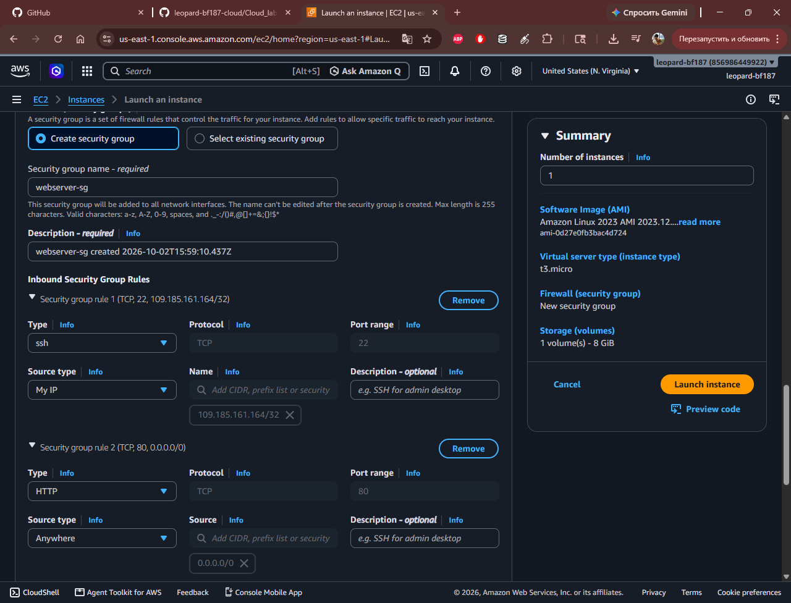

Для первоначальной настройки использован User Data:

```bash
#!/bin/bash
dnf -y update
dnf -y install htop nginx
systemctl enable --now nginx
```

После запуска экземпляр перешёл в состояние `Running`, проверки состояния были пройдены.

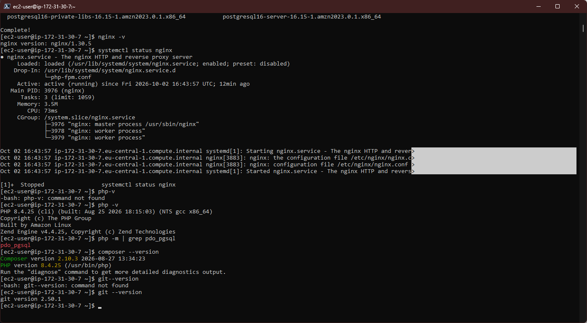

Стандартная страница nginx стала доступна по публичному IPv4 экземпляра:

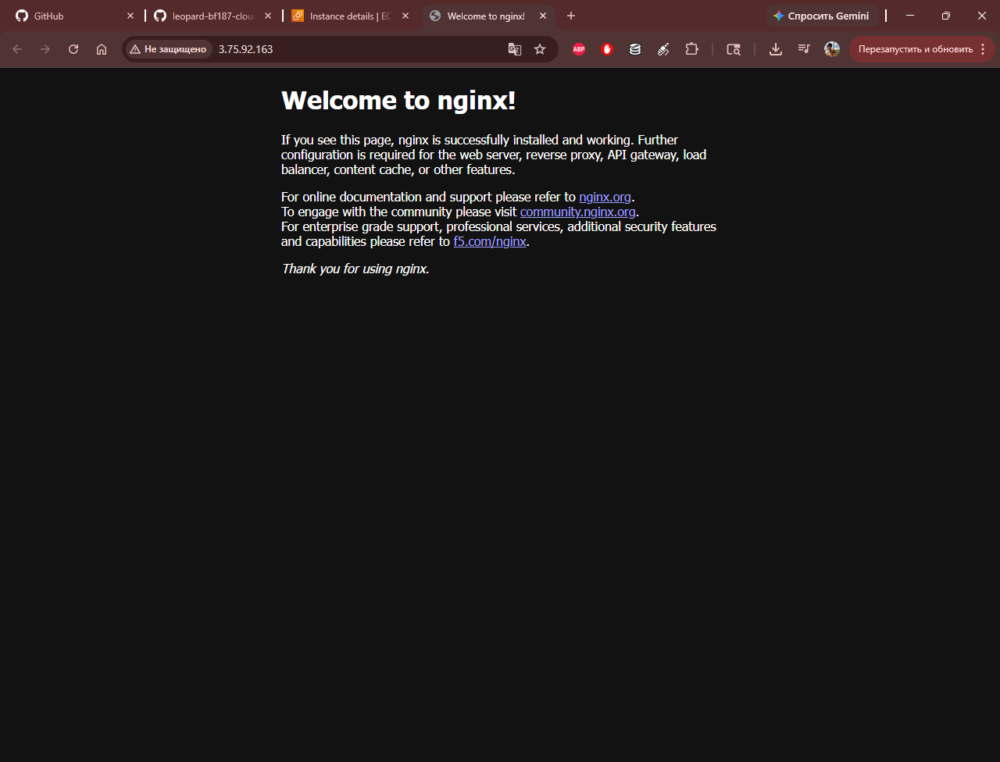

### Ответ на вопрос: что такое User Data и когда он выполняется?

User Data позволяет передать экземпляру сценарий первоначальной настройки. В данной работе сценарий выполняется при первом запуске экземпляра и автоматически устанавливает `htop` и `nginx`, после чего включает nginx. Обычная перезагрузка экземпляра не должна повторно выполнять этот сценарий как новый этап первоначальной настройки.

---

## 3.3. Мониторинг и диагностика

Были проверены системные проверки экземпляра:

- System status check;
- Instance status check;
- Attached EBS status check.

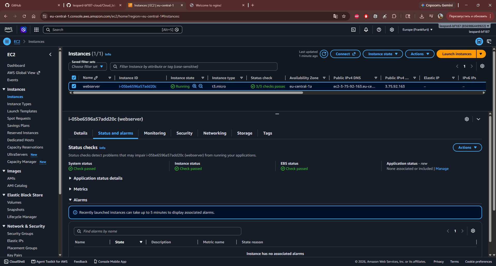

Также была открыта вкладка CloudWatch Monitoring с метриками CPU, сети и операций с диском.

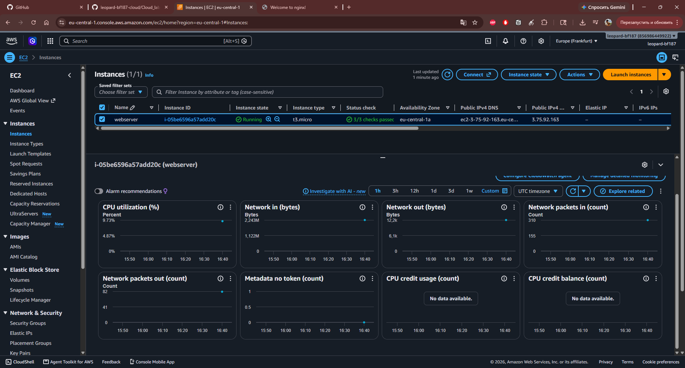

В System Log были найдены сообщения выполнения User Data и установки nginx.

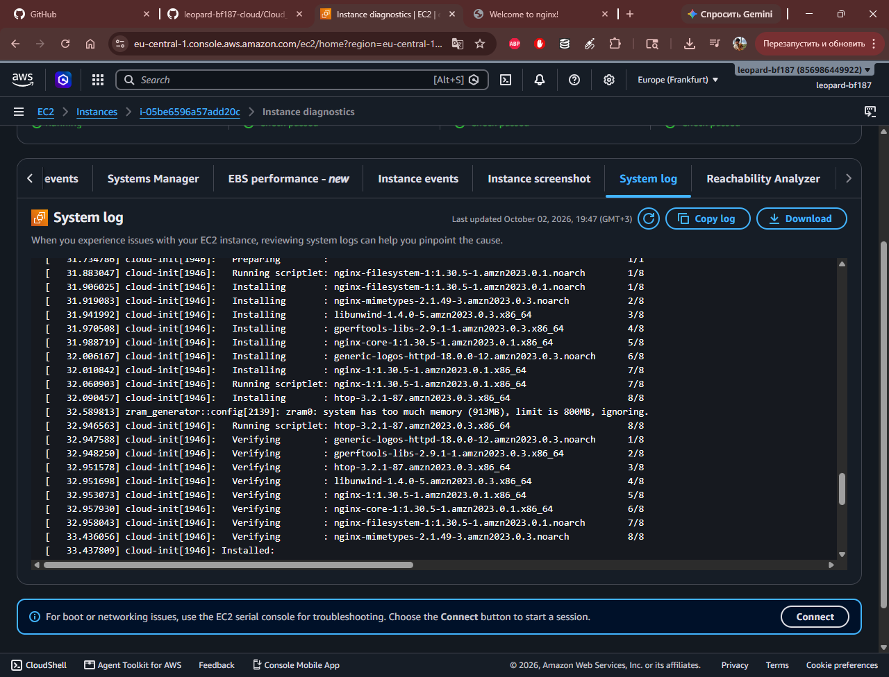

### Ответ на вопрос: какая проверка указывает на проблему пользователя, а какая — на проблему AWS?

`Instance status check` относится к состоянию гостевой операционной системы и виртуальной машины; такие проблемы часто можно диагностировать и исправлять со стороны пользователя. `System status check` отражает состояние физической инфраструктуры AWS и сетевого окружения хоста, поэтому сбой этой проверки чаще относится к стороне AWS.

### Ответ на вопрос: когда нужен Detailed Monitoring?

Detailed Monitoring полезен, когда метрик с интервалом около пяти минут недостаточно: например, для поиска коротких всплесков нагрузки, более быстрого срабатывания CloudWatch Alarms или анализа приложения с резко меняющейся нагрузкой. Для данной лабораторной базового мониторинга достаточно.

---

## 3.4. Подключение по SSH

Для подключения использовался приватный ED25519-ключ:

```powershell
ssh -i $HOME\.ssh\neural-emerald-aws-key.pem ec2-user@<Public-IP>
```

Успешное подключение:

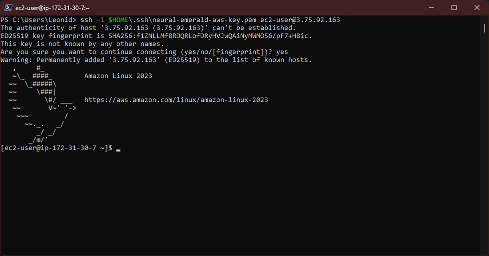

После входа проверено состояние nginx:

```bash
systemctl status nginx
```

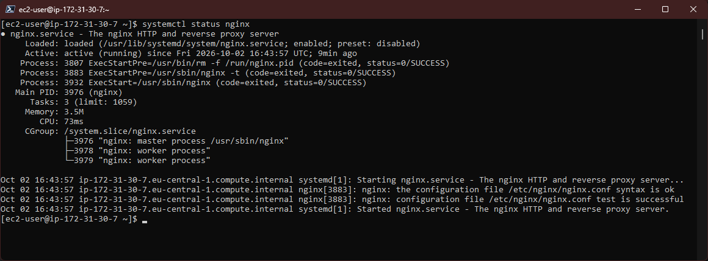

### Ответ на вопрос: почему для входа используется ключ, а не пароль?

SSH-ключ позволяет выполнять криптографическую аутентификацию без передачи пароля серверу. Приватный ключ остаётся на локальном компьютере, а на сервере используется соответствующий публичный ключ. Это уменьшает риск подбора пароля и является стандартным способом доступа к EC2.

---

# 4. Часть 2. Развёртывание собственного PHP-приложения

## 4.1. GitHub Organization и репозиторий

Для лабораторной была создана организация GitHub и публичный репозиторий:

```text
leopard-bf187-cloud/LaboratoryApp
```

В репозиторий помещён исходный код приложения. Файл `.env` и каталог `vendor/` не публикуются.

### Ответ на вопрос: почему `vendor/` и `.env` не находятся в репозитории?

`vendor/` создаётся Composer из `composer.lock`, поэтому хранить установленные зависимости в Git не требуется. `.env` содержит конфигурацию конкретного окружения, включая пароль к базе данных, и поэтому специально исключён через `.gitignore`.

---

## 4.2. Подготовка сервера

На EC2 были установлены компоненты, необходимые приложению:

```bash
sudo dnf -y install git composer postgresql16-server php8.4-fpm php8.4-cli php8.4-pgsql php8.4-mbstring php8.4-xml
```

Проверены nginx, PHP и драйвер PostgreSQL:

```bash
nginx -v
systemctl status nginx
php -v
php -m | grep pdo_pgsql
composer --version
git --version
```

### Ответ на вопрос: почему пакеты не добавлялись в User Data?

User Data в данной работе использовался только для базовой первоначальной настройки EC2. Набор пакетов для приложения появился после выбора и подготовки конкретного проекта, поэтому они устанавливались отдельно. Это также позволило выполнять настройку пошагово и проверять результат каждого этапа.

---

## 4.3. Настройка PostgreSQL

Кластер PostgreSQL был инициализирован:

```bash
sudo postgresql-setup --initdb
```

Проверены правила подключения:

```bash
sudo grep -v '^#' /var/lib/pgsql/data/pg_hba.conf | grep -v '^$'
```

Для соединений по паролю локальный `ident` был заменён на `scram-sha-256`:

```bash
sudo sed -i 's/ident$/scram-sha-256/' /var/lib/pgsql/data/pg_hba.conf
```

PostgreSQL включён и запущен:

```bash
sudo systemctl enable --now postgresql
systemctl status postgresql
```

Созданы отдельный пользователь и БД приложения:

```bash
sudo -u postgres psql -c "CREATE USER mooddiary WITH PASSWORD '<пароль>';"
sudo -u postgres psql -c "CREATE DATABASE mooddiary OWNER mooddiary;"
```

Проверка подключения:

```bash
psql -h localhost -U mooddiary -d mooddiary -c "SELECT 1;"
```

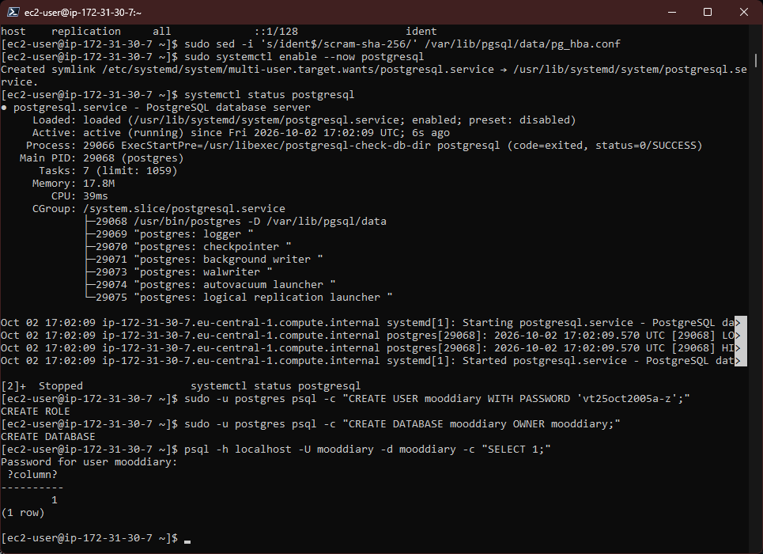

**Результат:** PostgreSQL принимает подключение пользователя `mooddiary`, запрос `SELECT 1` выполняется успешно.

---

## 4.4. Получение кода из GitHub и настройка приложения

Для приложения создан каталог:

```bash
sudo mkdir -p /var/www/mood-diary
sudo chown ec2-user:ec2-user /var/www/mood-diary
```

Репозиторий клонирован непосредственно сервером:

```bash
git clone https://github.com/leopard-bf187-cloud/LaboratoryApp.git /var/www/mood-diary
cd /var/www/mood-diary
ls -la
```

Создан серверный `.env` с параметрами локального PostgreSQL. Сам файл `.env` в отчёт и репозиторий не публикуется.

Права доступа:

```bash
chmod 640 .env
sudo chgrp apache .env
```

Composer установил зависимости приложения:

```bash
composer install --no-dev --optimize-autoloader
```

После этого применены миграции:

```bash
php migrate.php
```

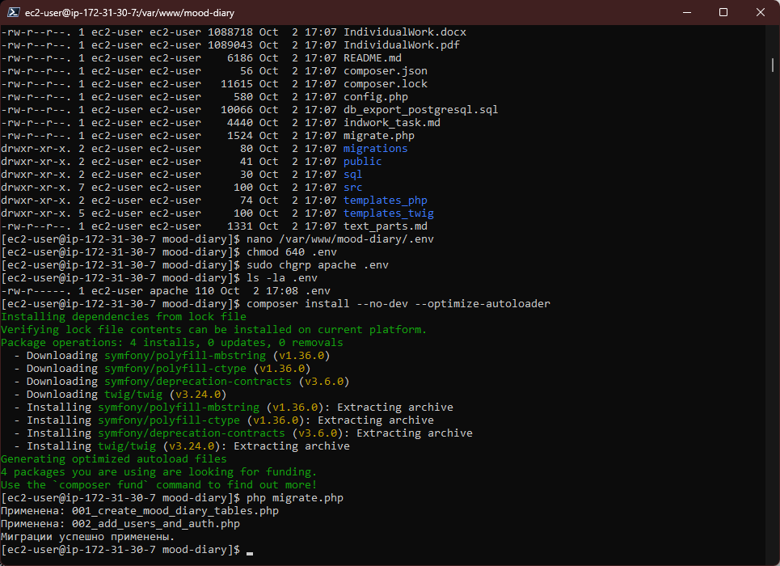

Дополнительно соединение с БД было проверено непосредственно через класс `Database`:

```bash
php -r "require 'src/Core/Database.php'; Database::getConnection(); echo \"DB OK\n\";"
```

### Ответ на вопрос: почему пароль хранится в `.env`, а не в репозитории?

Пароль относится к конфигурации конкретного окружения и является секретом. Если хранить его в публичном Git-репозитории, он станет доступен любому пользователю. Публичность исходного кода безопасна только при условии, что секреты, ключи и локальные конфигурации вынесены из репозитория.

---

## 4.5. Настройка PHP-FPM и nginx

PHP-FPM был включён и запущен:

```bash
sudo systemctl enable --now php-fpm
```

Проверено наличие Unix-сокета:

```bash
ls -l /run/php-fpm/www.sock
```

Для nginx создан виртуальный хост `/etc/nginx/conf.d/mood-diary.conf`:

```nginx
server {
    listen 80 default_server;
    listen [::]:80 default_server;

    root /var/www/mood-diary/public;
    index index.php;

    location = /health {
        include fastcgi_params;
        fastcgi_pass unix:/run/php-fpm/www.sock;
        fastcgi_param SCRIPT_FILENAME $document_root/health.php;
    }

    location / {
        try_files $uri $uri/ /index.php?$query_string;
    }

    location ~ \.php$ {
        try_files $uri =404;
        include fastcgi_params;
        fastcgi_pass unix:/run/php-fpm/www.sock;
        fastcgi_param SCRIPT_FILENAME $document_root$fastcgi_script_name;
    }

    location ~ /\. {
        deny all;
    }
}
```

Конфигурация проверена командой:

```bash
sudo nginx -t
```

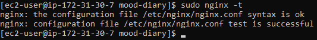

После этого nginx был перезапущен:

```bash
sudo systemctl restart nginx
```

Приложение стало доступно по публичному IPv4 экземпляра:

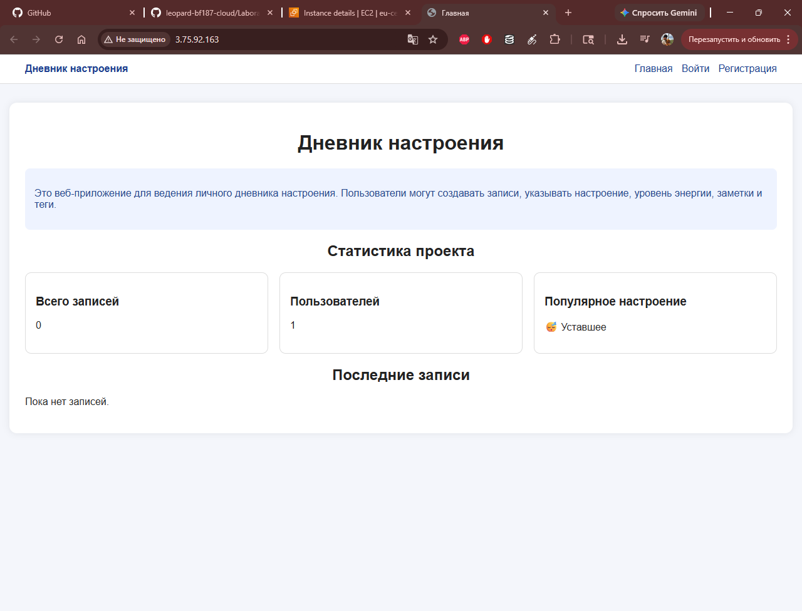

Для проверки состояния приложения был добавлен endpoint `/health`. Он проверяет выполнение PHP и доступность базы данных:

```json
{
    "status": "ok",
    "db": "ok"
}
```

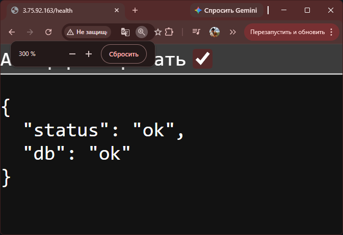

Внутри сервера проверка выполнялась командами:

```bash
curl http://localhost/health
curl -I http://localhost/
```

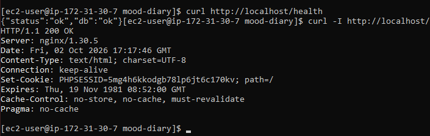

---

# 5. Обновление приложения через deploy.sh

Для воспроизводимого обновления приложения создан скрипт `~/deploy.sh`:

```bash
#!/bin/bash
set -euo pipefail

cd /var/www/mood-diary

echo "==> Забираем новый код из GitHub"
git pull --ff-only

echo "==> Устанавливаем зависимости"
composer install --no-dev --optimize-autoloader --no-interaction

echo "==> Применяем миграции"
php migrate.php

echo "==> Перезагружаем PHP-FPM"
sudo systemctl reload php-fpm

echo "Готово. На сервере коммит: $(git log -1 --oneline)"
```

Скрипт сделан исполняемым:

```bash
chmod +x ~/deploy.sh
```

После проверки на сервере деплой был запущен непосредственно с локального Windows-компьютера:

```powershell
ssh -i $HOME\.ssh\neural-emerald-aws-key.pem ec2-user@<Public-IP> ./deploy.sh
```

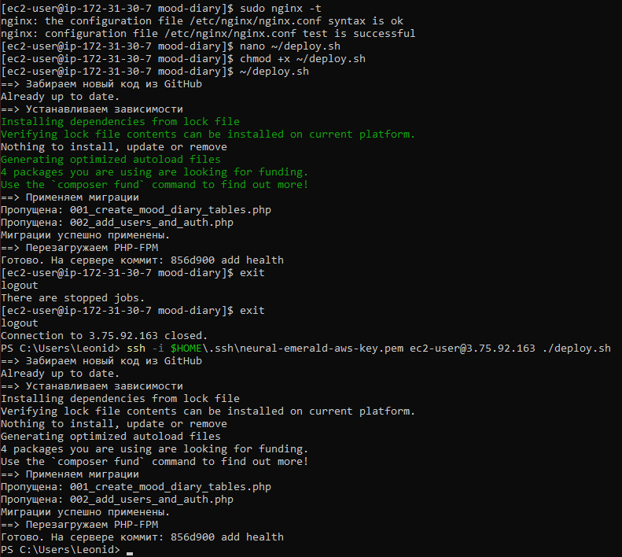

Таким образом, типичный выпуск новой версии выполняется по цепочке:

```text
Локальный компьютер
       |
       | git push
       v
     GitHub
       |
       | git pull --ff-only
       v
      EC2
       |
       +--> composer install
       +--> php migrate.php
       +--> reload PHP-FPM
```

### Что может произойти во время `git pull`?

Рабочие файлы приложения обновляются непосредственно в каталоге, из которого nginx обслуживает запросы. Пользователь, попавший на сайт в этот момент, теоретически может получить состояние, в котором часть файлов уже относится к новой версии, а часть ещё нет. Если после обновления кода не выполнить `composer install`, новая версия может ожидать зависимости, которых ещё нет в `vendor/`, что приведёт к ошибке приложения.

---

# 6. Выпуск новой версии, намеренная поломка и откат

Перед экспериментом в приложении была создана тестовая запись. Затем в шаблон была добавлена заметная строка с автором, изменение отправлено в GitHub и развёрнуто через `deploy.sh`.

Рабочая версия после обновления:

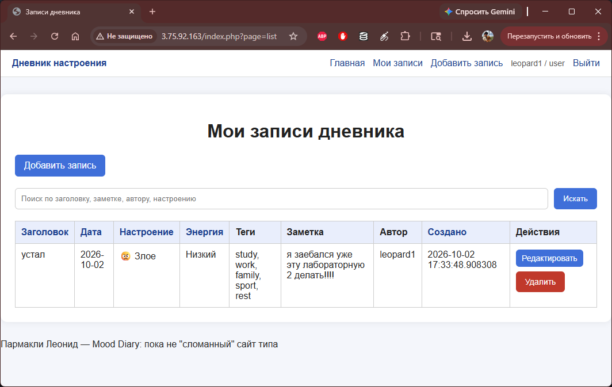

После этого в шаблон была намеренно добавлена синтаксическая ошибка и выполнен очередной деплой. Главная страница перестала работать и вернула HTTP 500:

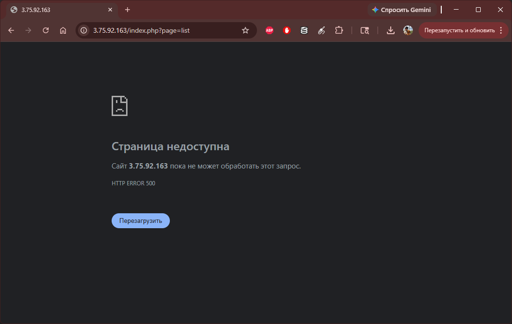

При этом `/health` продолжал проверять инфраструктурный путь PHP + PostgreSQL и не зависел от рендеринга конкретного Twig-шаблона.

### Почему `/health` может быть `ok`, когда главная страница не работает?

Endpoint `/health` выполняется отдельным PHP-файлом и проверяет, что PHP работает и соединение с PostgreSQL доступно. Ошибка в Twig-шаблоне главной страницы не затрагивает этот путь. Такой health-check неполон: он не проверяет рендеринг пользовательских страниц, работоспособность всех маршрутов и корректность бизнес-логики.

Для восстановления код не редактировался непосредственно на сервере. На локальном компьютере выполнен откат через Git:

```bash
git revert --no-edit HEAD
git push
```

После этого снова запущен `deploy.sh`:

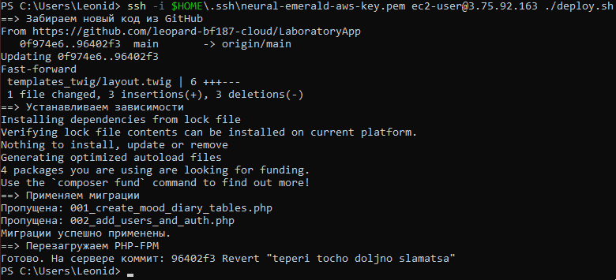

В результате сайт снова заработал, а ранее сохранённые данные остались в PostgreSQL:

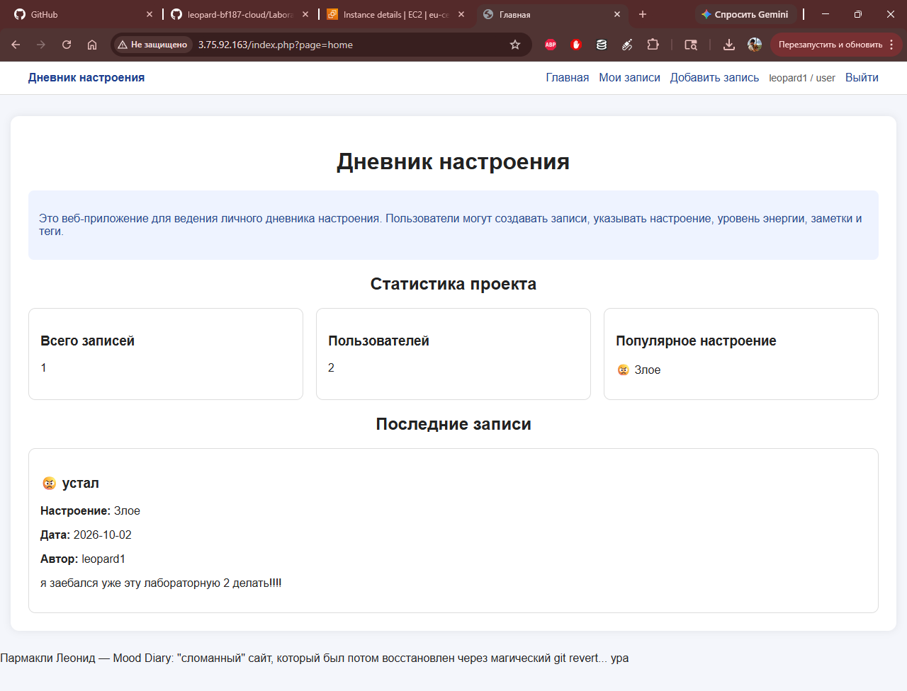

### Сколько времени сайт был недоступен и как уменьшить это время?

Точное время недоступности во время эксперимента отдельно не фиксировалось. Оно состояло из времени обнаружения ошибки, создания и отправки revert-коммита и повторного запуска `deploy.sh`. Сократить его можно автоматическими тестами до деплоя, CI/CD, проверкой health-check после развёртывания, автоматическим rollback и атомарной схемой релизов, при которой рабочая версия переключается только после полной подготовки новой.

---

# 7. Архитектура развёртывания

Архитектурная схема выполнена с учётом фактически использованных компонентов: AWS Cloud, регион Frankfurt, Default VPC, Availability Zone, Subnet, Security Group, EC2, nginx, PHP-FPM, PostgreSQL, внешний GitHub и локальный компьютер.

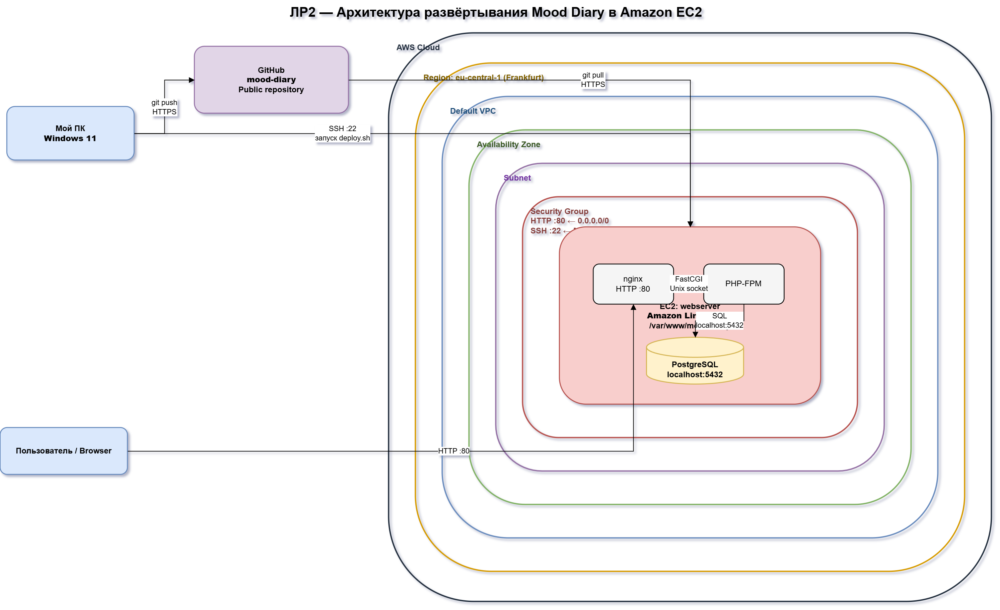

Редактируемый файл схемы: [`images/lab2_mood_diary_aws_architecture.drawio`](images/lab2_mood_diary_aws_architecture.drawio)

Основные потоки:

- пользователь → nginx: HTTP, порт 80;
- nginx → PHP-FPM: FastCGI через Unix-сокет;
- PHP-FPM → PostgreSQL: SQL, `localhost:5432`;
- локальный ПК → GitHub: `git push`;
- EC2 → GitHub: `git pull` по HTTPS;
- локальный ПК → EC2: SSH, порт 22, запуск `deploy.sh`.

ADR по выбранному способу развёртывания: [`docs/adr/0001-deploy-method.md`](docs/adr/0001-deploy-method.md)

---

# 8. Ответы на контрольные вопросы продвинутого уровня

## 8.1. Как запрос проходит от браузера до базы данных?

Браузер отправляет HTTP-запрос на публичный IP EC2, где порт 80 обслуживает nginx. Для статических файлов nginx может вернуть содержимое самостоятельно; PHP-запрос он передаёт PHP-FPM через Unix-сокет `/run/php-fpm/www.sock`. PHP-код приложения при необходимости использует PDO и отправляет SQL-запросы PostgreSQL, который работает на том же экземпляре и доступен только локально на порту 5432.

## 8.2. Почему сервер может скачивать код, но не может отправлять изменения в GitHub?

Репозиторий публичный, поэтому чтение кода по HTTPS не требует аутентификации. Для `git push` необходимо предоставить GitHub учётные данные или специальный ключ с правом записи; серверу такие права не выдавались. Это безопаснее, потому что компрометация EC2 не должна автоматически давать злоумышленнику возможность изменить исходный репозиторий.

## 8.3. Что произойдёт с файлами при удалении экземпляра EC2?

При обычном `Stop` содержимое EBS-тома сохраняется, поэтому после повторного `Start` файлы, конфигурация и PostgreSQL остаются на месте. При `Terminate` корневой EBS-том обычно настроен на удаление вместе с экземпляром; в таком случае локально сохранённые файлы и база данных будут потеряны. Поэтому важные данные в реальной архитектуре необходимо хранить с учётом резервного копирования и политики жизненного цикла EBS.

## 8.4. Что общего у deploy.sh с CI/CD и чего ещё не хватает?

`deploy.sh` автоматически выполняет повторяемую последовательность доставки новой версии: получает код, устанавливает зависимости, применяет миграции и перезагружает PHP-FPM. Это напоминает deployment-стадию CI/CD. В текущем варианте отсутствуют автоматический запуск по событию в Git, сборка и тестирование, отдельное окружение, проверка результата деплоя, стратегия zero-downtime и автоматический rollback.

---

# 9. Дополнительные ответы на вопросы по работе

### Чем Stop отличается от Terminate и за что платят при остановленном экземпляре?

`Stop` выключает вычислительный экземпляр, но сохраняет его EBS-тома и конфигурацию. `Terminate` удаляет экземпляр; корневой EBS при стандартной настройке также удаляется. При остановленном EC2 не начисляется плата за вычислительное время экземпляра, однако сохраняемые EBS-тома продолжают занимать оплачиваемое хранилище.

### Почему PostgreSQL использует отдельного пользователя приложения?

Приложение не должно работать от имени административного пользователя PostgreSQL. Пользователь `mooddiary` владеет своей базой и используется только приложением, что уменьшает область возможного ущерба при компрометации его учётных данных.

### Почему база не открыта через Security Group?

PostgreSQL находится на том же EC2, что и приложение, и PHP подключается к `localhost:5432`. Открывать порт 5432 в интернет для данной архитектуры не требуется и небезопасно.

---

# 10. Вывод

В ходе лабораторной работы был создан и настроен экземпляр Amazon EC2 в регионе `eu-central-1`. На сервере были развёрнуты nginx, PHP-FPM, PostgreSQL, Git и Composer. Собственное PHP-приложение было адаптировано для Linux и публичного Git-репозитория, после чего сервер самостоятельно получил его из GitHub.

База данных была инициализирована и настроена на парольную аутентификацию, зависимости установлены через Composer, а структура БД создана миграциями приложения. nginx был настроен как веб-сервер, передающий PHP-запросы PHP-FPM через Unix-сокет.

Для обновления приложения был создан `deploy.sh`, объединяющий получение кода, установку зависимостей, миграции и перезагрузку PHP-FPM. Процесс был проверен не только на успешном обновлении, но и на намеренно ошибочном релизе с последующим восстановлением через `git revert`. Таким образом, в работе были практически изучены базовые принципы облачного развёртывания, управления вычислительным экземпляром, безопасной конфигурации, мониторинга, доставки кода и отката версии.


