# Лабораторная работа №6 — Масштабирование и балансировка нагрузки в AWS

**Дисциплина:** Cloud Computing  
**Студент:** Пармакли Леонид  
**Группа:** IA2404ru  
**Специальность:** Прикладная информатика  
**Уровень:** продвинутый (задания 4–7)  
**Дата:** 18.11.2026  
**Регион AWS:** `eu-central-1` (Frankfurt)  
**Приложение:** [MoodDiary / LaboratoryApp](https://github.com/leopard-bf187-cloud/LaboratoryApp)  
**Реализация приложения:** [ветка `feat/cloud-lab6-dynamodb-sessions`](https://github.com/leopard-bf187-cloud/LaboratoryApp/tree/feat/cloud-lab6-dynamodb-sessions)  
**Материалы лабораторной:** [Cloud_labs, ветка `Lab6`](https://github.com/leopard-bf187-cloud/Cloud_labs/tree/Lab6)

---

## 1. Цель и объём работы

**Цель:** обеспечить распределение запросов к PHP-приложению между несколькими EC2 с помощью Application Load Balancer (ALB), настроить автоматическое масштабирование EC2 Auto Scaling по нагрузке и перенести PHP-сессии в DynamoDB, чтобы вход пользователя сохранялся при смене сервера.

Вместо учебного TimeCapsule используется собственное приложение **MoodDiary** — дневник настроения на PHP, Nginx и PostgreSQL. Архитектура предыдущих лабораторных сохранена: данные приложения находятся в **Amazon RDS for PostgreSQL**, а вложения — в **Amazon S3**.

С согласия преподавателя отдельные учебные задания **1–3 базового уровня не выполнялись**. В заданиях **4–7 продвинутого уровня** аналогичные механизмы балансировки, проверки здоровья, масштабирования и нагрузочного тестирования были проверены непосредственно на MoodDiary. В отчёте не заявляются отдельные тесты базовой демонстрационной nginx-инфраструктуры.

**Итог:** сессии перенесены в DynamoDB; приложение работало через ALB на двух EC2 в разных зонах доступности; подтверждён переход между серверами без потери авторизации; выполнен десятиминутный тест нагрузки с автоматическим увеличением **2 → 3** и последующим уменьшением **3 → 2** экземпляров.

## 2. Архитектура системы

| Компонент | Реальная конфигурация ЛР6 |
|---|---|
| AWS Region / VPC | `eu-central-1`, `vpc-student-leonid-parmacli`, `10.0.0.0/16` |
| Public subnet A | `public-subnet-leonid-parmacli`, `10.0.0.0/24`, `eu-central-1a` |
| Public subnet B | `public-subnet-b-parmacli-leonid`, `10.0.1.0/24`, `eu-central-1b` |
| Application Load Balancer | `mood-diary-dev-alb`, Internet-facing, listener HTTP:80 |
| Target Group | `mood-diary-dev-tg`, Instances, HTTP:80, health check `/health.php` |
| Auto Scaling Group | `mood-diary-dev-asg`, первоначально Min/Desired/Max = **2/2/4** |
| Scaling policy | `mood-diary-dev-request-tracking`, ALB RequestCountPerTarget, target value **50** |
| EC2 Launch Template | `mood-diary-dev-app-lt`, `t3.micro`, IAM instance profile |
| Образ приложения | `mood-diary-dev-app-lab6-v2`, включает обновлённый MoodDiary |
| DynamoDB | `mood-diary-dev-sessions`, ключ `id` (String), TTL `expires`, On-demand |
| IAM | `mood-diary-dev-app-sessions`, роль `timecapsule-dev-app-role` |
| База данных | `mooddiary-dev-rds`, PostgreSQL 16, Single-AZ, приватный доступ |
| Приватный DNS | `db.timecapsule.internal` → CNAME на endpoint RDS |
| Файловое хранилище | S3 `timecapsule-dev-uploads-leopard` |

Входящий HTTP к серверам ASG разрешён только от SG балансировщика `mood-diary-dev-alb-sg`; SSH — от группы безопасности `bastion`. Для RDS разрешён PostgreSQL/TCP 5432 от SG приложений `mood-diary-dev-asg-sg`, без публичного доступа к базе.

**Путь пользовательского запроса:** браузер → ALB → исправный EC2 (Nginx → PHP-FPM → MoodDiary) → DynamoDB для PHP-сессии и RDS для пользовательских данных. Вложения читаются/записываются в S3 через AWS SDK. Для подключения к RDS используется приватная запись Route 53.

### Редактируемая схема

[Открыть архитектуру Draw.io](images/Lab6_MoodDiary_AWS_Architecture.drawio)

**Светлая версия:**

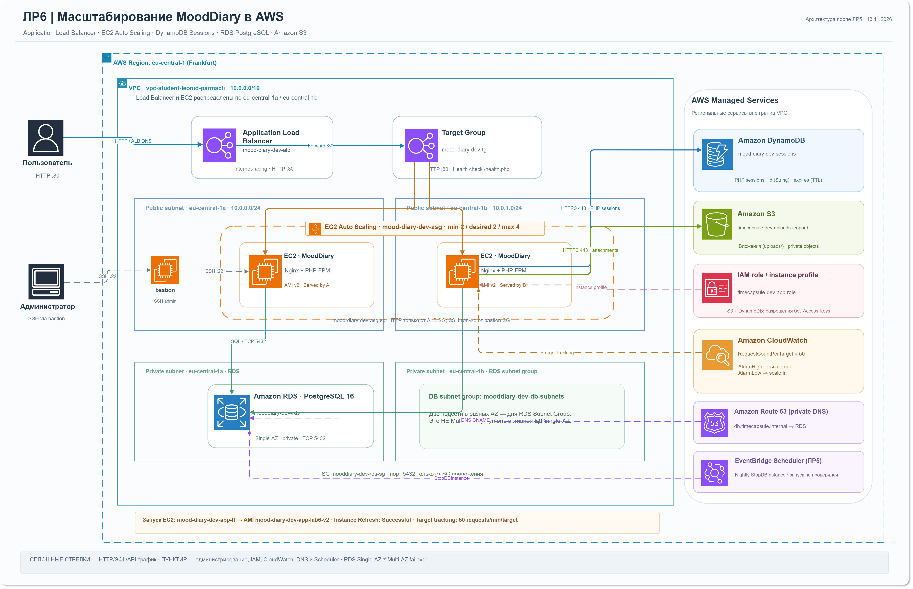

**Тёмная версия:** [Открыть PNG](images/Lab6_MoodDiary_AWS_Architecture_Dark.png).

> Схема отражает конфигурацию во время тестирования. После завершения ЛР6 параметры ASG были изменены для остановки вычислительных ресурсов; изображение не следует трактовать как текущее состояние запущенных EC2.

## 3. Задание 4 — Перенос PHP-сессий в Amazon DynamoDB

### 3.1. Таблица и IAM

Создана таблица `mood-diary-dev-sessions` в режиме **On-demand**. Ключ раздела — `id` типа `String`; для автоматической очистки просроченных сессий включён **TTL** по атрибуту `expires`.

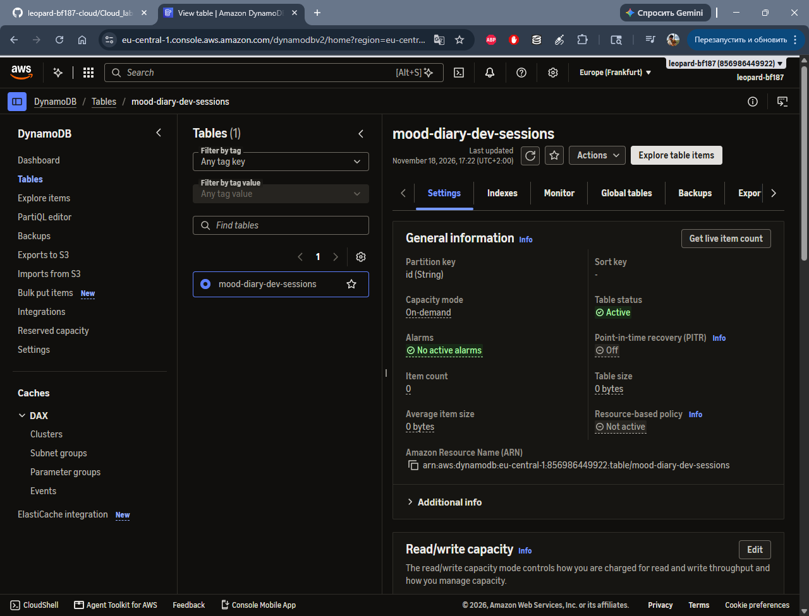

Создана IAM-политика `mood-diary-dev-app-sessions` с операциями `dynamodb:GetItem`, `dynamodb:PutItem`, `dynamodb:UpdateItem`, `dynamodb:DeleteItem`, ограниченными ARN таблицы. Политика прикреплена к IAM-роли EC2 `timecapsule-dev-app-role`, уже использовавшейся для S3. Статические AWS access keys в `.env` не добавлялись.

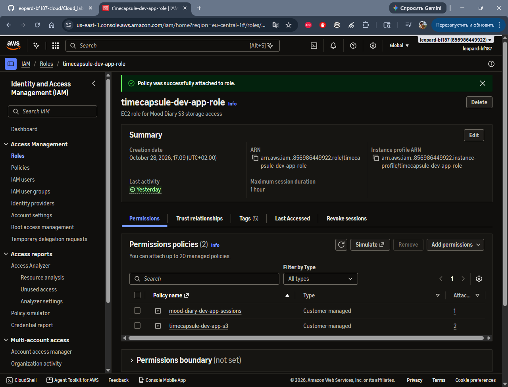

### 3.2. Изменения приложения

В ветке [feat/cloud-lab6-dynamodb-sessions](https://github.com/leopard-bf187-cloud/LaboratoryApp/tree/feat/cloud-lab6-dynamodb-sessions) добавлен класс `src/Core/SessionStorage.php` и изменён запуск сессий в `public/index.php`. После подключения Composer autoload обработчик DynamoDB регистрируется **до** `session_start()`. При пустом параметре таблицы остаются стандартные файловые PHP-сессии — это полезно для локальной разработки.

Фрагмент рабочего алгоритма:

```php
$client = new DynamoDbClient(['version' => 'latest', 'region' => $region]);
$handler = SessionHandler::fromClient($client, ['table_name' => $tableName, 'hash_key' => 'id', 'session_lifetime_attribute' => 'expires', 'locking' => false]);
$handler->register();
session_start();
```

В конфигурации сервера установлены `AWS_REGION=eu-central-1` и `DYNAMODB_SESSIONS_TABLE=mood-diary-dev-sessions`. Сам `.env` не публикуется.

После обновления приложения вход выполнялся успешно, а в **DynamoDB → Explore table items** появилась запись PHP-сессии. Идентификатор и содержимое сессии в отчёте не приводятся.

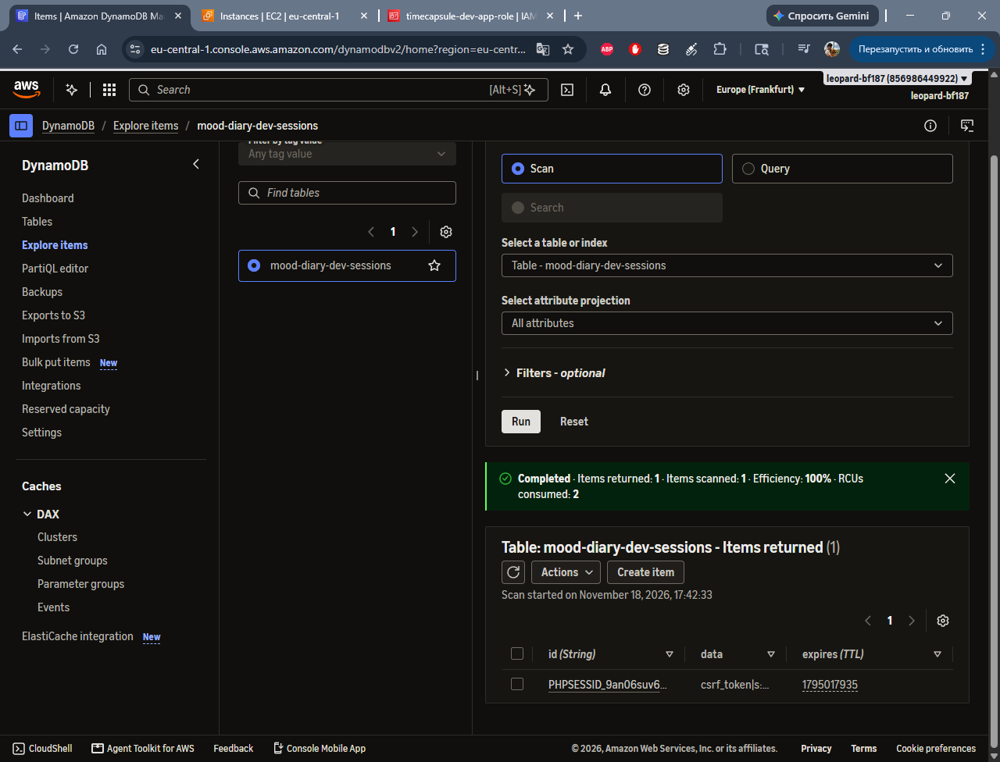

**Результат:** состояние авторизации хранится вне EC2 и может использоваться любым сервером приложения, имеющим соответствующую роль IAM.

## 4. Задание 5 — ALB и EC2 Auto Scaling для MoodDiary

### 4.1. Безопасность, AMI и шаблон запуска

Созданы группы безопасности ALB и ASG. Веб-серверы группы принимают HTTP **только от ALB**; доступ по SSH ограничен `bastion`. Для RDS разрешены обращения от SG экземпляров ASG.

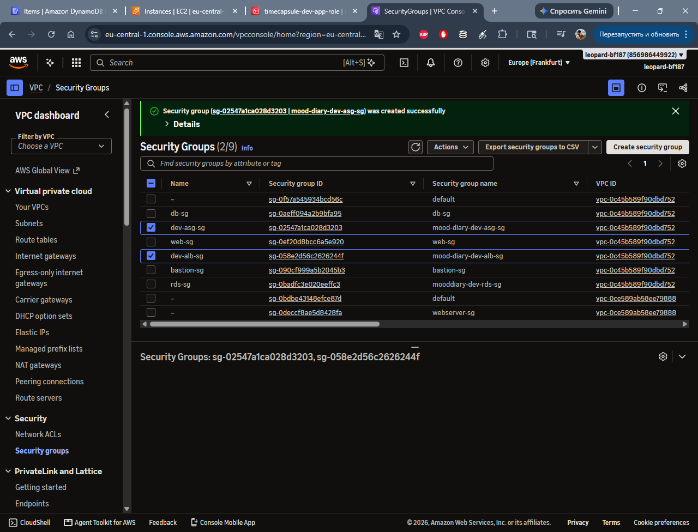

Из первоначального `app-server` создан образ приложения; позже, после добавления поля `Served by`, собран обновлённый AMI **`mood-diary-dev-app-lab6-v2`**. Шаблон запуска `mood-diary-dev-app-lt` использует `t3.micro`, выбранную пару SSH-ключей, SG приложения и IAM instance profile. Подсети задаются на уровне ASG, а не фиксируются в шаблоне.

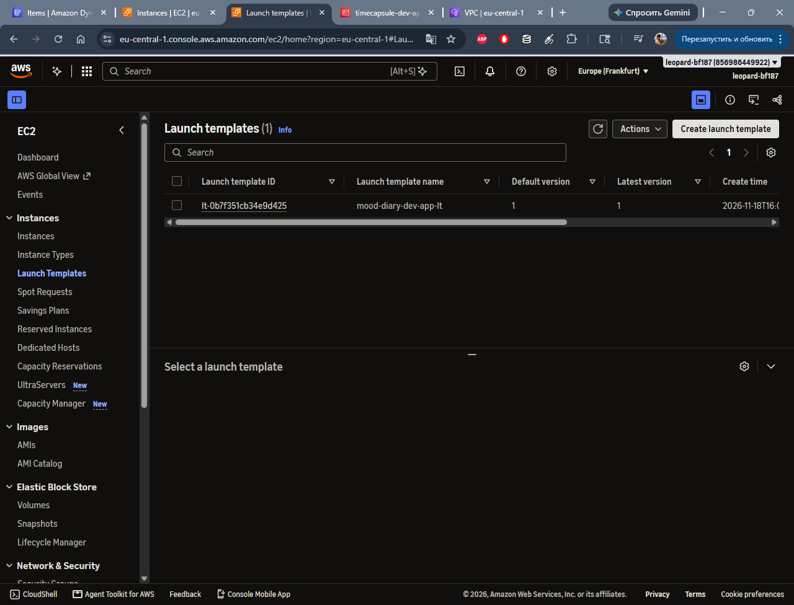

### 4.2. Target Group, ALB и ASG

Создана целевая группа `mood-diary-dev-tg` с типом `Instances`, протоколом HTTP на порту 80 и путём проверки **`/health.php`**. Этот endpoint обращается к RDS через PDO, выполняет `SELECT 1` и при доступности базы возвращает HTTP 200 с JSON `{"status":"ok","db":"ok"}`; при ошибке БД возвращает HTTP 500.

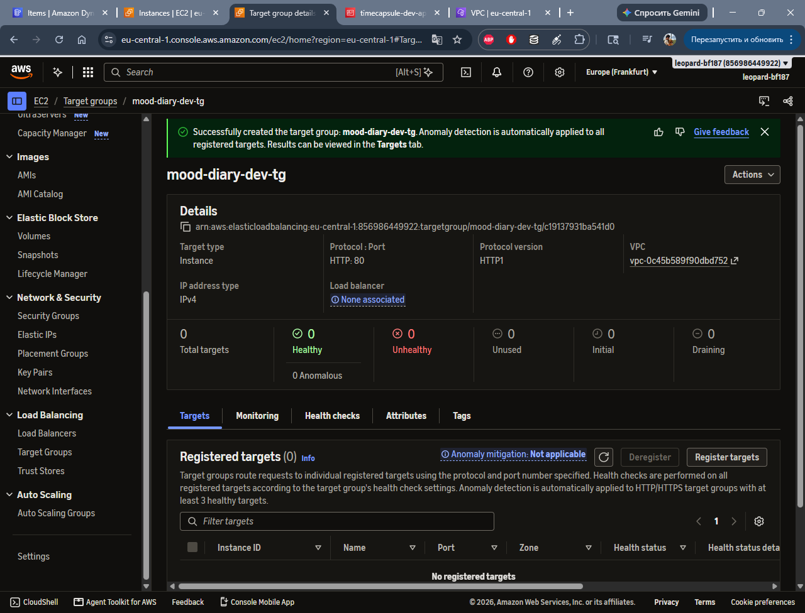

Создан Internet-facing ALB `mood-diary-dev-alb` в двух публичных подсетях (`eu-central-1a` и `eu-central-1b`) с HTTP listener на порту 80. Во время работы проверки проводились по DNS `mood-diary-dev-alb-687909283.eu-central-1.elb.amazonaws.com`; после удаления ALB этот адрес больше не является действующей точкой входа.

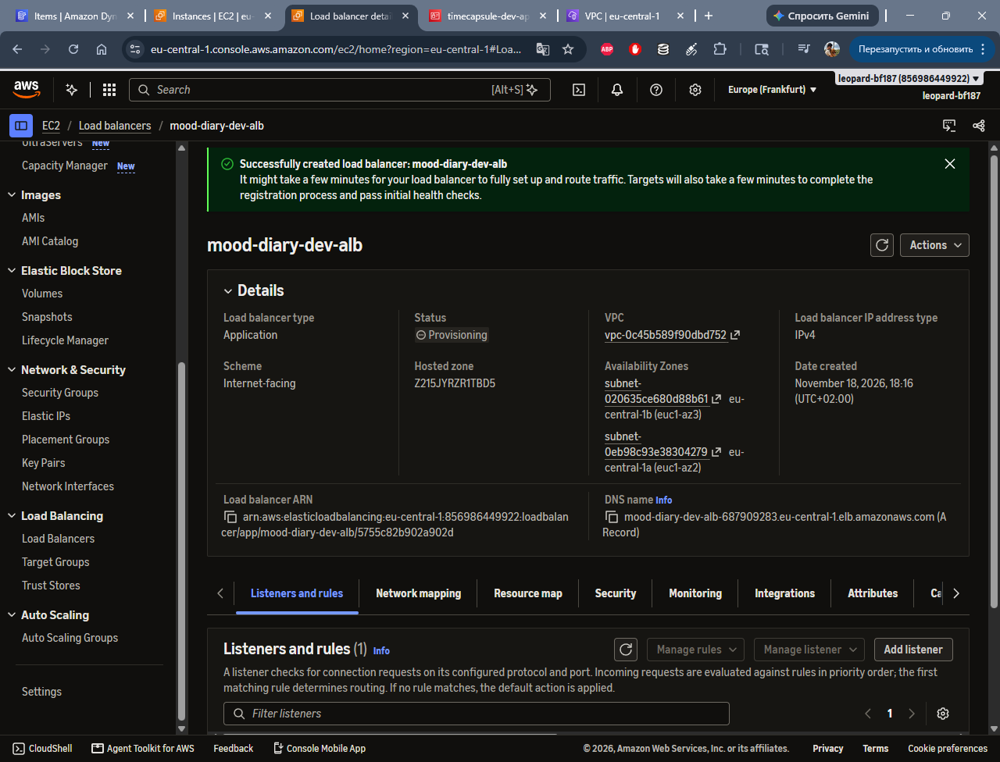

Создана группа `mood-diary-dev-asg` с первоначальными параметрами **Min = 2, Desired = 2, Max = 4**, проверками здоровья ELB и политикой `mood-diary-dev-request-tracking` с целевым значением `RequestCountPerTarget = 50`. При запуске два EC2 перешли в `InService`, обе цели Target Group — в `Healthy`.

| EC2 в ASG | Цели Target Group |
|---|---|
| 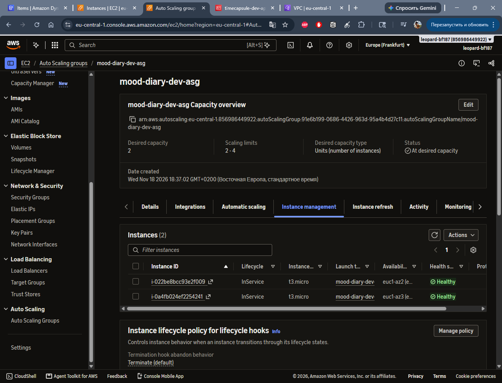 | 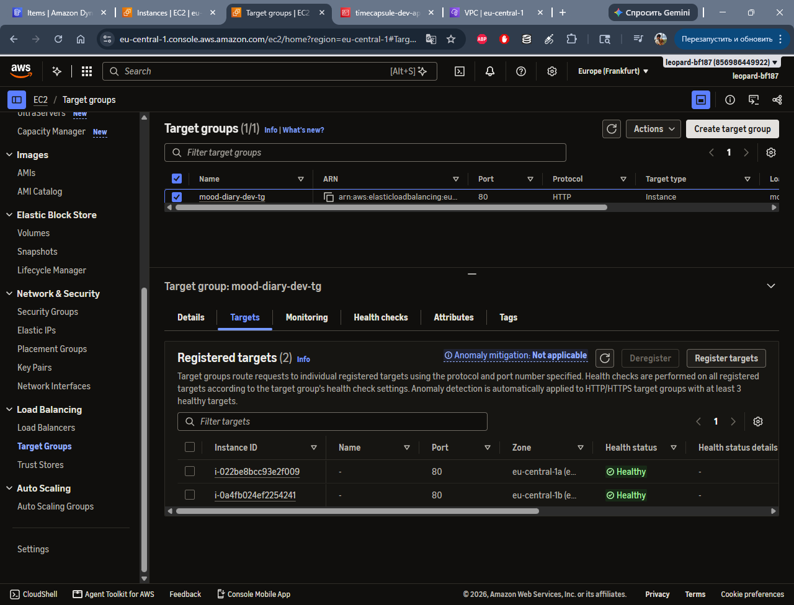 |

### 4.3. Обновление AMI и проверка постоянства сессии

Для проверки реальной балансировки в общий Twig-шаблон добавлена строка **`Served by: {{ served_by|default('unknown') }}`**, а в представление передаётся имя текущего EC2 через `gethostname()`. Первая AMI не содержала это изменение; поэтому образ был пересоздан (v2), обновлена версия Launch Template и запущен **Instance Refresh** без одномоментного прекращения работы всех серверов.

| Обновление экземпляров | Завершение обновления |
|---|---|
| 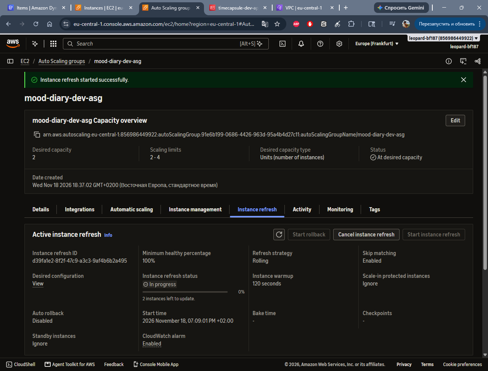 | 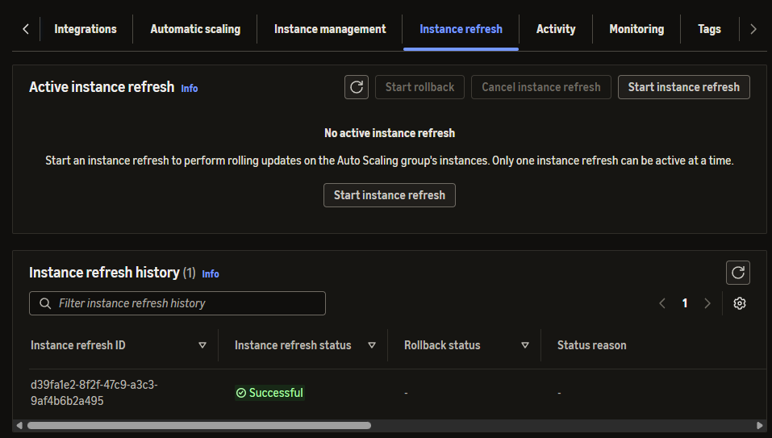 |

После успешного обновления при повторных обращениях через ALB значение `Served by` менялось, при этом **вход пользователя сохранялся**. Это подтвердило, что серверы взаимозаменяемы и используют общую таблицу сессий DynamoDB. Первоначальный `app-server` был остановлен, его Elastic IP отвязан и освобождён.

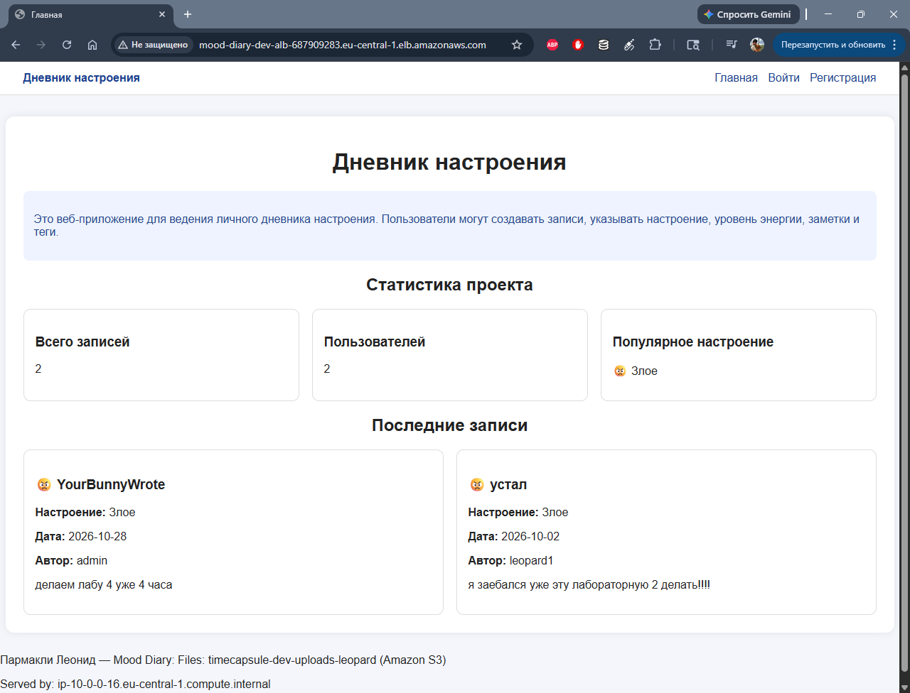

**Результат:** приложение доступно через единую точку входа; оба экземпляра обслуживают запросы, а сессия не зависит от конкретной EC2.

## 5. Задание 6 — Нагрузочное тестирование и автоматическое масштабирование

### 5.1. Методика

В Git Bash запущен десятиминутный цикл HTTP-запросов к MoodDiary через DNS ALB, с интервалом около 0,1 с между попытками. Вызывался маршрут `index.php?page=home`; для каждого `curl` был задан таймаут 10 с.

```bash
ALB="mood-diary-dev-alb-687909283.eu-central-1.elb.amazonaws.com"
end=$((SECONDS+600))
count=0
while [ "$SECONDS" -lt "$end" ]; do
    curl -s --max-time 10 -o /dev/null "http://$ALB/index.php?page=home"
    count=$((count+1))
    sleep 0.1
done
echo "Requests attempted: $count"
```

Скрипт завершился. Точное число отправленных запросов отдельно не зафиксировано в материалах; производительность по RPS не вычислялась и не заявляется.

### 5.2. Scale-out

В CloudWatch сработала тревога **`TargetTracking-mood-diary-dev-asg-AlarmHigh`**; в истории активности Auto Scaling появилось событие запуска дополнительной EC2. Число экземпляров увеличилось **с 2 до 3**, третий экземпляр перешёл в состояние `InService`.

| CloudWatch | Активность ASG |
|---|---|
| 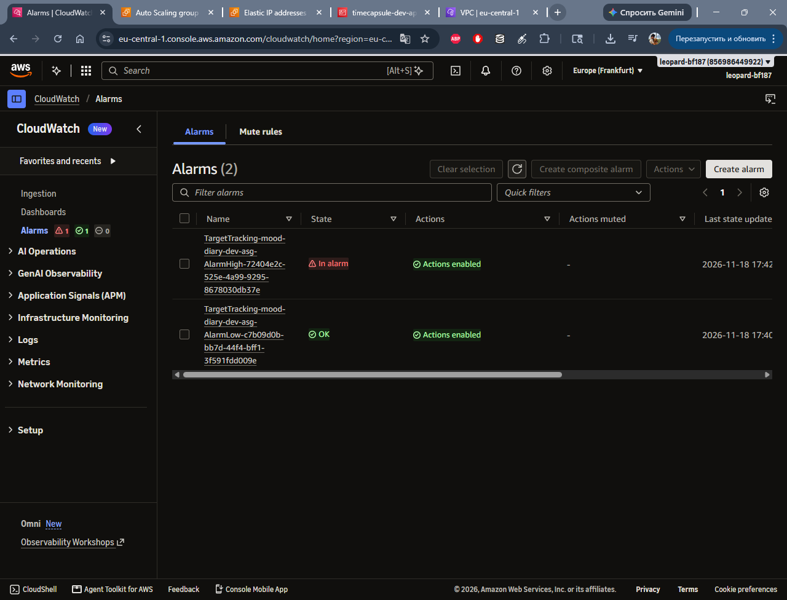 | 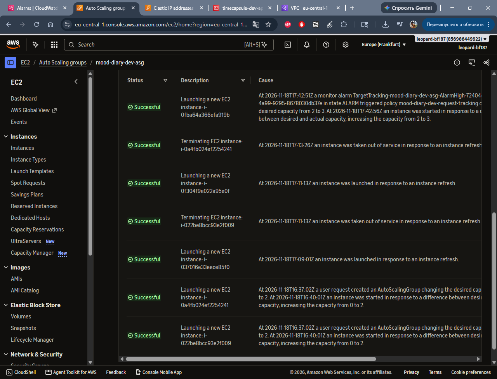 |

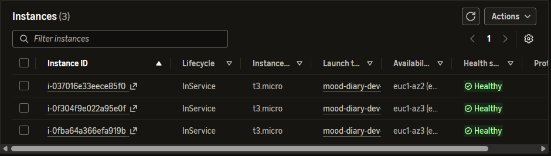

### 5.3. Scale-in

После окончания нагрузочного теста тревога `AlarmHigh` вернулась в `OK`, а **`AlarmLow` перешла в `In alarm`**. Auto Scaling уменьшил желаемую ёмкость с трёх экземпляров до двух; в журнале Activity зафиксировано завершение лишнего EC2 и этап `Connection draining`.

| AlarmLow | Завершение EC2 |
|---|---|
| 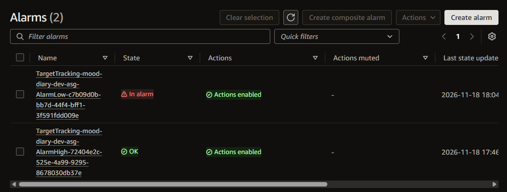 | 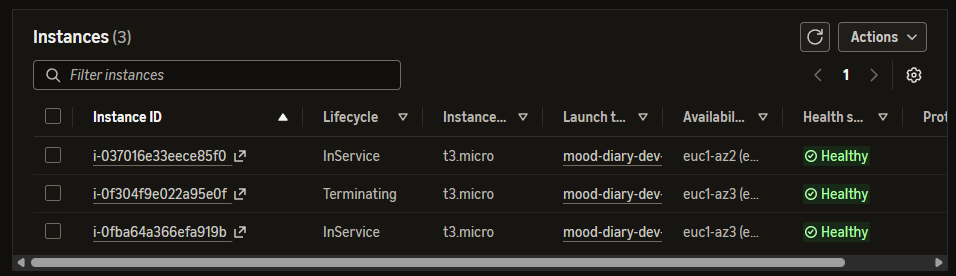 |

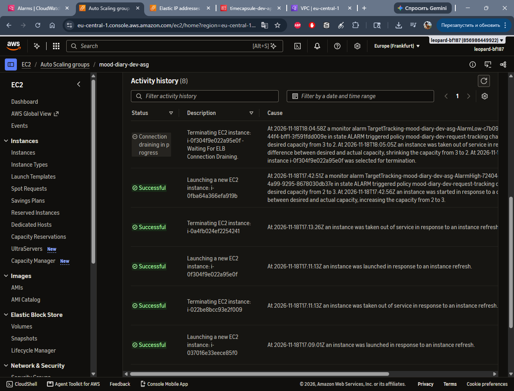

По окончании процесса осталось **два экземпляра `InService`**. Авторизация MoodDiary при возврате к двум серверам **сохранилась**. Повторная отдельная проверка `Healthy` именно после Scale-in не зафиксирована скриншотом; первоначальное состояние двух целей `Healthy` подтверждено в задании 5.

### 5.4. Результаты теста

| Проверка | Наблюдение | Итог |
|---|---|---|
| Стартовая ёмкость | 2 EC2 `InService` | Успешно |
| Высокая нагрузка | `AlarmHigh` → запущен третий EC2 | Успешно |
| Scale-out | 2 → 3 EC2, новый сервер `InService` | Успешно |
| Завершение нагрузки | Десятиминутный скрипт завершился | Успешно |
| Низкая нагрузка | `AlarmLow` → событие Terminating | Успешно |
| Scale-in | 3 → 2 EC2, оба оставшихся `InService` | Успешно |
| Пользовательская сессия | Вход сохранялся при смене серверов и после Scale-in | Успешно |
| Максимум 4 EC2 | Лимит настроен, фактически достигнуто 3 | Не проверялось |
| Новая запись дневника именно во время нагрузки | Отдельного подтверждения нет | Не заявляется |

## 6. Задание 7 — Архитектура и ADR

Архитектура ЛР5 расширена ALB, двумя публичными AZ для EC2, ASG, DynamoDB и CloudWatch. Сохранены S3, приватная RDS, Route 53, bastion и IAM. Редактируемая схема и две версии PNG находятся в каталоге `images/`.

Для решения о хранении сессий подготовлен **[ADR-0005 — Session Storage](ADR-0005-session-storage.md)**. В нём сравниваются три варианта: локальные файлы со sticky sessions на ALB, отдельная таблица PostgreSQL в RDS и DynamoDB On-demand. Выбрана DynamoDB, потому что хранение состояния пользователя становится независимым от срока жизни конкретного EC2.

Важное ограничение отказоустойчивости: **RDS по-прежнему Single-AZ**. Поэтому наличие ALB и EC2 в двух зонах не гарантирует работоспособность приложения при недоступности самой базы данных.

## 7. Ответы на контрольные вопросы

### 7.1. Почему сессии нельзя оставить файлами, если серверов несколько?

Локальные файлы сессии существуют только на конкретном EC2. При следующем запросе ALB может выбрать другой сервер, который не найдёт сессию и сочтёт пользователя неавторизованным; при удалении первого сервера файлы также исчезнут. DynamoDB предоставляет общее хранилище сессий всем серверам.

### 7.2. Для чего в Node.js используется `initialized: true`?

В варианте учебного приложения на Node.js параметр сигнализирует драйверу сессий, что таблица DynamoDB уже подготовлена для использования; он помогает избежать повторного выполнения этапа инициализации. В нашем варианте MoodDiary используется PHP и обработчик AWS SDK, поэтому данный параметр **не применяется**.

### 7.3. Почему Elastic IP больше не нужен?

Входная точка для браузера теперь — DNS-имя ALB, а не публичный адрес отдельного EC2. Экземпляры Auto Scaling могут запускаться и завершаться, поэтому привязка одного Elastic IP к серверу противоречит их взаимозаменяемости. Адрес исходного `app-server` после переключения приложения на ALB был освобождён.

### 7.4. Почему у экземпляров ASG одинаковые `.env` и секреты?

Все экземпляры созданы из одной AMI, подготовленной на базе настроенного `app-server`; образ содержит одинаковые параметры подключения к RDS, DynamoDB и S3. Это обеспечивает единое поведение приложения независимо от того, какой EC2 обслуживает запрос. Вместе с тем секреты внутри AMI требуют ограничения доступа и безопасного обновления; для промышленной эксплуатации предпочтительнее AWS Secrets Manager или Parameter Store.

### 7.5. Что станет с `/health.php`, если остановить RDS?

Endpoint выполняет SQL-запрос `SELECT 1` к PostgreSQL и при ошибке подключения возвращает HTTP 500. После нескольких неудачных проверок Target Group пометит цели как `Unhealthy`, даже если Nginx и PHP продолжают работать. При включённых ELB health checks ASG может попытаться заменить такие серверы, хотя источник проблемы — общая недоступность RDS.

### 7.6. Пришлось ли снова входить при масштабировании и почему?

Нет: авторизация сохранялась при переключении между серверами и после возвращения ASG с трёх экземпляров к двум. Сведения о входе извлекаются из DynamoDB, а не из файлового хранилища конкретного EC2. Поэтому удаление экземпляра не удаляет пользовательскую сессию.

### 7.7. Сколько серверов запустила группа и почему не больше четырёх?

Группа начинала с двух EC2 и при нагрузке добавила ещё один, достигнув трёх одновременно работающих экземпляров. Значение Max = 4 задаёт верхнюю границу, а не цель, которую группа обязана достигать. Target tracking добавляет столько экземпляров, сколько требует текущая метрика; четвёртый сервер в тесте не понадобился.

### 7.8. Почему `RequestCountPerTarget` уменьшается после добавления сервера?

Метрика рассчитывается как нагрузка на одну цель, а не как сумма всех входящих запросов. Если число запросов распределяется между большим числом исправных EC2, среднее количество запросов на экземпляр уменьшается, даже если общий поток не изменился. Это и есть цель горизонтального масштабирования.

### 7.9. Почему Scale-out происходит быстрее, чем Scale-in?

При росте нагрузки дополнительные ресурсы нужны для предотвращения ошибок и задержек, поэтому система быстрее реагирует на нехватку производительности. При снижении нагрузки AWS выдерживает стабилизационные интервалы, чтобы не удалить серверы из-за кратковременного спада и не вызвать постоянных колебаний размера группы. Для ALB также учитывается безопасное завершение уже обслуживаемых соединений (`Connection draining`).

### 7.10. Как запрос проходит от браузера до базы и таблицы сессий?

Браузер отправляет HTTP-запрос на DNS ALB, балансировщик выбирает исправную цель в Target Group, а Nginx передаёт PHP-запрос в PHP-FPM. Обработчик сессий PHP читает или записывает состояние в DynamoDB по IAM-роли экземпляра. Бизнес-данные MoodDiary запрашиваются из приватной RDS PostgreSQL через имя `db.timecapsule.internal`; вложения хранятся в S3.

### 7.11. Чем health check ALB отличается от health check Auto Scaling?

Проверка Target Group определяет, можно ли направлять запросы на конкретный EC2; ALB исключает нездоровую цель из обычного распределения трафика при наличии здоровых целей. Проверка ASG с включённым типом `ELB` использует состояние балансировщика для управления жизненным циклом: экземпляр, признанный неисправным после учёта настроенного grace period, может быть заменён. Таким образом, ALB отвечает за маршрутизацию, а ASG — за поддержание требуемой ёмкости группы.

### 7.12. Что произойдёт при отказе `eu-central-1a`?

ALB может продолжить обслуживание через исправные EC2 в `eu-central-1b`, а ASG будет стремиться поддерживать заданную ёмкость там, где ресурсы доступны. DynamoDB не зависит от одного EC2 или одной AZ. Однако рабочая RDS в данной учебной конфигурации — **Single-AZ**; при отказе AZ, в которой расположен её активный экземпляр, приложение потеряет доступ к бизнес-данным до восстановления базы, а `/health.php` станет возвращать ошибку.

## 8. Завершение работы и расходы

После тестов для `mood-diary-dev-asg` выбраны **Min = 0, Desired = 0, Max = 4**, чтобы завершить работающие EC2 и сохранить конфигурацию группы. Политику target tracking следует отключить либо проконтролировать, что она не восстанавливает ёмкость. Состояние удаления ALB и остановки других сервисов фиксируется отдельно: представленные скриншоты подтверждают испытания, но **не подтверждают окончательную очистку ресурсов**.

В соответствии с методичкой продвинутого уровня необходимо **удалить ALB**, но сохранить DynamoDB, Target Group, IAM policy, AMI и Launch Template. RDS и bastion следует остановить; ресурсы S3 с вложениями — сохранить. AMI/EBS snapshots, S3 и хранилище RDS могут тарифицироваться после выключения вычислительных экземпляров, а остановленный RDS автоматически запускается не позднее чем через семь дней.

## 9. Вывод

В ЛР6 приложение MoodDiary переведено с одного EC2 на архитектуру с балансировщиком ALB и группой EC2 Auto Scaling в двух Availability Zones. PHP-сессии перенесены в DynamoDB и проверены на сохранение авторизации при изменении обслуживающего экземпляра. В ходе десятиминутной нагрузки CloudWatch и Auto Scaling продемонстрировали успешный цикл **2 → 3 → 2** с автоматическим Scale-out и Scale-in.

Архитектурная схема дополнена компонентами балансировки и распределённых сессий, а выбор DynamoDB обоснован в ADR-0005. Ограничение учебной системы — одиночный RDS PostgreSQL Single-AZ; для настоящей высокой доступности данных потребуется отдельное решение по резервированию базы и защите HTTPS.

---

**Дополнительные файлы:** [методичка](cloud_lab6.md) · [команды развёртывания](commands.txt) · [IAM policy (шаблон)](policy.txt) · [нагрузочный скрипт](testing-alb.txt). В `policy.txt` указан заполнитель `ACCOUNT_ID`, не следует публиковать фактический номер аккаунта AWS или содержимое PHP-сессий.
